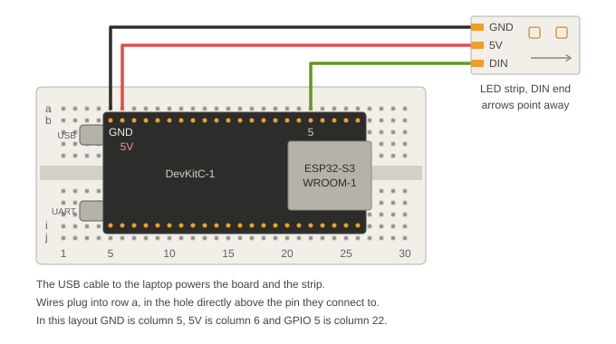

# LED strip desk test (21 Nov)

On 21 Nov we got the 1 m strip from the bay to play a moving rainbow from an ESP32-S3 DevKitC-1. It was powered from a laptop over USB, with no power board and no extra parts. This page covers step 2 of [#72](https://github.com/Electrium-Mobility/Bakfiets-F26/issues/72). The power board test and the current measurement are still to do.

## Parts

- ESP32-S3 DevKitC-1 (ESP32-S3-WROOM-1 module)
- The 1 m WS2812B strip from the bay, 144 LEDs
- A breadboard, three jumper wires and a USB-C data cable

## Wiring

| Board pin | Strip pad |
| --- | --- |
| 5V | 5V |
| GND | GND |
| GPIO 5 | DIN |

The board sits across the middle gap of the breadboard, so its pins fill rows b and i. The jumper wires go into row a, directly above the pins. On a clone board the pins can be in a different order, so go by the names printed next to the pins.

Data has to go in at the strip's DIN end, which is the end the printed arrows point away from. On our strip the black 3-pin plug was on the other end, where the arrows point towards it, so we wired to the DIN end instead.

## Uploading the code

The code is [`firmware/strip-test/strip-test.ino`](../../firmware/strip-test/strip-test.ino). It needs the FastLED library, which you can install from *Sketch > Include Library > Manage Libraries*.

1. Plug the cable into the board's **USB** port.
2. Choose *Tools > Board > esp32 > **ESP32S3 Dev Module***.
3. Under *Tools > Port*, choose the port that appears when the board is plugged in. It was COM7 on the laptop we used.
4. Click Upload. It worked when the log ended with "Hash of data verified" and "Hard resetting via RTS pin". If the strip stays dark after that, press RESET on the board once.

Since the strip runs from USB, the code limits it to 400 mA and brightness 30. At full white, 144 LEDs can draw over 8 A.

## Problems we hit

- **No COM port on the UART port.** Windows saw the board's CP2102N chip, but had no driver for it (error 28 in Device Manager). The **USB** port works without a driver on Windows 11. To use UART, install the Silicon Labs CP210x driver.
- **Wrong board selected.** The IDE had ESP32S31 Dev Module selected, which is a different chip. ESP32S3 Dev Module, the plain one, is the right choice. Avoid the "Octal (WROOM2)" entry too.
- **Slow first build.** The first build compiles the ESP32 core and FastLED from scratch, which took several minutes. Builds after that took seconds.
- **Upload stuck on "Connecting...".** Hold BOOT, tap RESET, release BOOT, then upload again.

## Next

- Test the bay power board on the bench supply, then run the strip from it ([#72](https://github.com/Electrium-Mobility/Bakfiets-F26/issues/72), step 1).
- Measure the strip's current at the brightness we plan to use, and post the number on #72.
- Plan where to cut the turn signal and brake light pieces once the light spots are measured on the bike ([#53](https://github.com/Electrium-Mobility/Bakfiets-F26/issues/53)).
