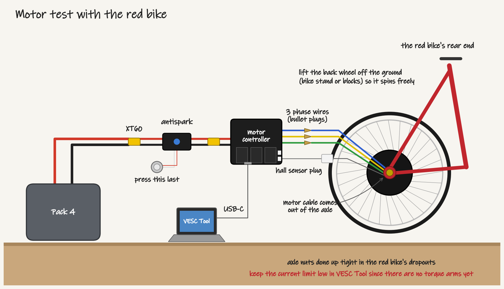

# Team meeting: Wednesday 4 November 2026

6:30 pm in the Electrium Room in the Bay. If you had a task due today, bring what you have so far.

| Time | What |
| --- | --- |
| 6:30 | Updates, the task board and the budget |
| 6:40 | Subteam time. Electrical starts with the motor test |

Updates since last week:

- The task board is at [quaot.github.io/bakfiets](https://quaot.github.io/bakfiets/), and all our links are in [docs/links.md](../links.md), including the [budget sheet](https://uofwaterloo-my.sharepoint.com/:x:/g/personal/j227gu_uwaterloo_ca/IQCsv4FbH6WNQaxoSS-1gZffAU3B5GUIUrFj3gSvtGA6blw?e=4oCbkK).
- We have $300 for the term. Our estimate for the rest of the parts is $258 to $616 with tax. The range is wide because a lot of the prices are still estimates.
- The front brake cable route is 228 cm ([#32](https://github.com/Electrium-Mobility/Bakfiets-F26/issues/32)). We put in an order on Amazon.ca for a Tektro RS360A lever pair, a Jagwire 1.5 x 3500 mm MTB brake cable and 3 m of 5 mm lined housing, $88.37 with tax. We're keeping the existing Shimano mechanical disc caliper on the front.
- For the rear brake we're using the mechanical disc brake from Electrium's green mountain bike, on the table by the whiteboard ([#34](https://github.com/Electrium-Mobility/Bakfiets-F26/issues/34)). The second RS360A lever pulls it, so both brakes use cable. The caliper mount on the seat stay is still being designed.
- Annie finished the steering arm in CAD ([#25](https://github.com/Electrium-Mobility/Bakfiets-F26/issues/25)). The rod is next, with a McMaster-Carr ball joint rod end ([CAD model](https://www.mcmaster.com/59935K43-59935K83/)) at each end.
- We're planning to reweld the back of the frame so the 48 V 2000 W hub motor fits ([#37](https://github.com/Electrium-Mobility/Bakfiets-F26/issues/37)). Only the dimensions change in CAD, so the brake design still works.
- Pack 4 (48 V, 12S2P) now has an XT60H-F on its main leads and has been checked. It has a BMS built in and the charger works with it.
- The RS360A levers have no switch, so we'll add two Grin magnetic brake sensors (CA$21 each at ebikes.ca) before the first ride ([#40](https://github.com/Electrium-Mobility/Bakfiets-F26/issues/40)). They plug into the motor controller's ADC2 input.

Mechanical (Annie, Aarush):

- Model the steering rod in a new part file and mate it in the assembly ([#25](https://github.com/Electrium-Mobility/Bakfiets-F26/issues/25)).
- Take the brake off the green mountain bike ([#34](https://github.com/Electrium-Mobility/Bakfiets-F26/issues/34)). Check if the caliper is post mount or IS mount and take a photo, since the seat stay mount has to match. Measure its cable as well. If it's too short, we'll buy a 2 m MTB brake cable and housing.
- Rear stays ([#37](https://github.com/Electrium-Mobility/Bakfiets-F26/issues/37)) and torque arms ([#31](https://github.com/Electrium-Mobility/Bakfiets-F26/issues/31)).

Electrical (Jack):

- Start with the motor test, steps below ([#18](https://github.com/Electrium-Mobility/Bakfiets-F26/issues/18)).
- After the test, go over the research tasks due today: motor controller ([#38](https://github.com/Electrium-Mobility/Bakfiets-F26/issues/38)), thumb throttle ([#39](https://github.com/Electrium-Mobility/Bakfiets-F26/issues/39)), brake cut-off ([#40](https://github.com/Electrium-Mobility/Bakfiets-F26/issues/40)) and lights ([#43](https://github.com/Electrium-Mobility/Bakfiets-F26/issues/43)).
- The store-bought 5 V converter for the power board, a Bel DQD20-48-S5-T (18 to 75 V in, 20 W out), is the plan ([#9](https://github.com/Electrium-Mobility/Bakfiets-F26/issues/9)). Kira's total current for the lights from #43 tells us if 20 W is enough.
- Add the Sayal XLR charging socket, XLR plug and XT30 pair to the parts list ([#11](https://github.com/Electrium-Mobility/Bakfiets-F26/issues/11)) and take out the two 15 A fuses.

Firmware (David):

- Decide between one ESP32 or two boards on CAN ([#16](https://github.com/Electrium-Mobility/Bakfiets-F26/issues/16)).
- The turn signal pull request is approved and ready to merge ([#13](https://github.com/Electrium-Mobility/Bakfiets-F26/issues/13)).
- One firmware member joins electrical for the motor test to help with VESC Tool. While the controller is connected, find its UART (TX, RX) and CAN (CANH, CANL) pins for the ESP32 link ([#22](https://github.com/Electrium-Mobility/Bakfiets-F26/issues/22)).

If you don't have a task yet, pick one from the [task board](https://quaot.github.io/bakfiets/) and comment on its issue.

Motor test steps ([#18](https://github.com/Electrium-Mobility/Bakfiets-F26/issues/18)). The hub motor is already on the spare bike with the red rear end, so we'll test it there. Jack handles the battery, and the firmware member runs VESC Tool.

1. Lift the back wheel so it can spin.
2. Plug the motor's three phase wires (bullet plugs) and the hall sensor plug into the motor controller. Then connect Pack 4's XT60 to the antispark and the antispark's XT60 to the controller. Press the antispark button last.
3. Plug a laptop into the controller's USB-C port and open VESC Tool. Write down the model, firmware and ports it shows for #38.
4. Before spinning anything, set battery type Li-ion, 12 cells in series, cutoff start 40.8 V and end 37.2 V, motor current max 10 A, battery current max 3 A and max power 500 W. Keep it gentle since the torque arms aren't on yet.
5. Run the FOC motor detection wizard, then spin the wheel slowly from VESC Tool.

Next meeting: Wed 11 Nov.

Notes from the meeting:

Attendance:

Decisions:

Action items:
