# Research images

Pictures the team made in their research Google Docs, saved here so they are easy to find and link. Each folder links back to its doc.

## Bike lights

From [Kira's research doc](https://docs.google.com/document/d/13qpAB194niJQpVrAXE_byD5UovOfIgmfKc3w-b4PG_w/edit) for [#43](https://github.com/Electrium-Mobility/Bakfiets-F26/issues/43).

Where each light goes, sketched on the 2024 render

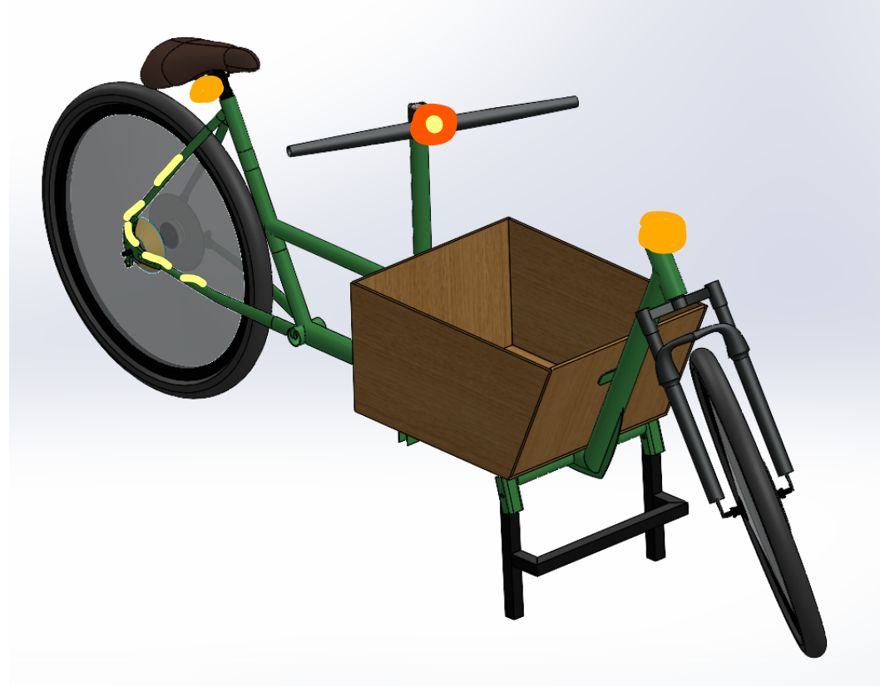

## Torque arms

From [Nishanth's research doc](https://docs.google.com/document/d/19N-Zn_2HQC00fz9eG4jLP9s8k8fXu2ZGgnC9GTbSzPY/edit) for [#31](https://github.com/Electrium-Mobility/Bakfiets-F26/issues/31).

Axle flats, 9.68 mm

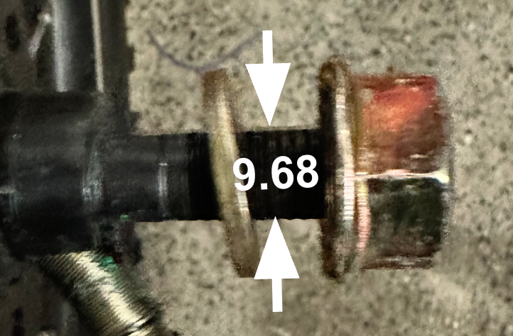

Whole axle length, 213.58 mm

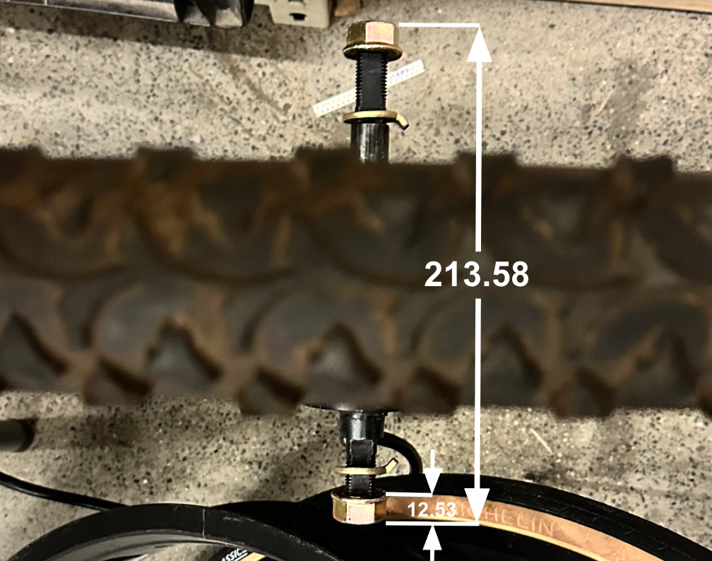

Dropout slot, 9.93 mm

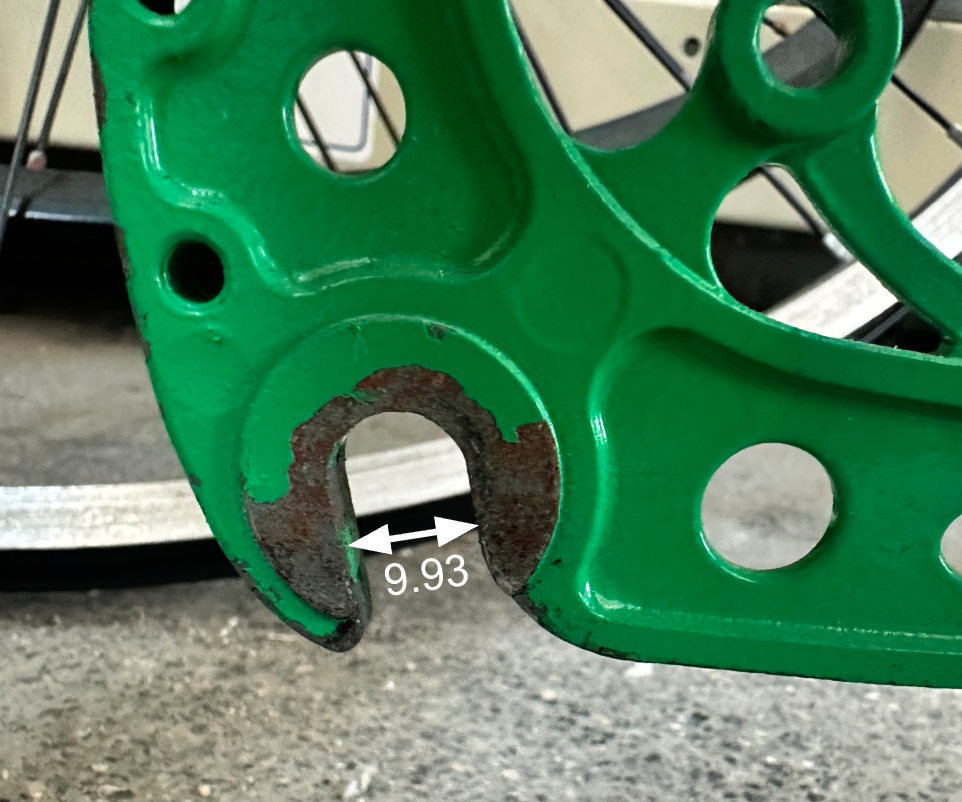

Gap between the rear dropouts, 119.55 mm, measured before they were adjusted

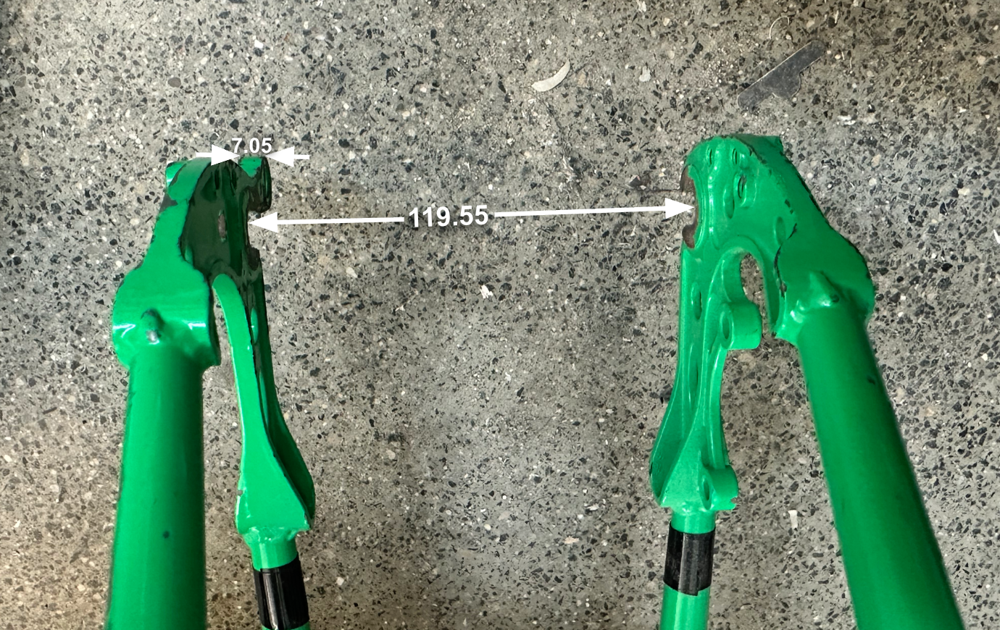

## Steering

From [Annie's research doc](https://docs.google.com/document/d/1EZ8nsjwT7Efdmq1i6udGsr1uA6-Z1iEPCEvqlJxssBE/edit) for [#25](https://github.com/Electrium-Mobility/Bakfiets-F26/issues/25).

Cable steering loop between the handlebar drum and the fork drum

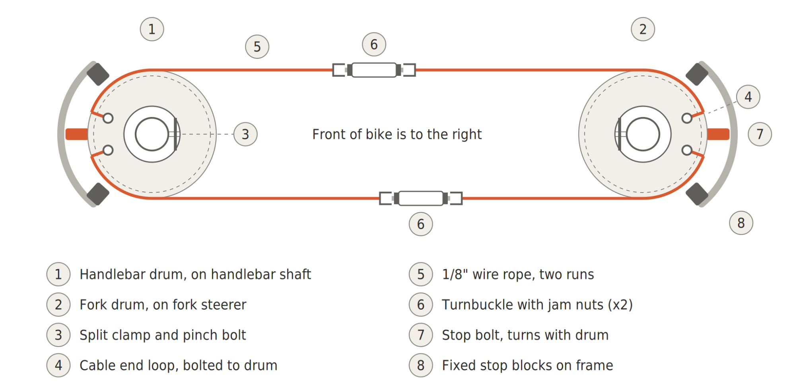

How each cable end connects

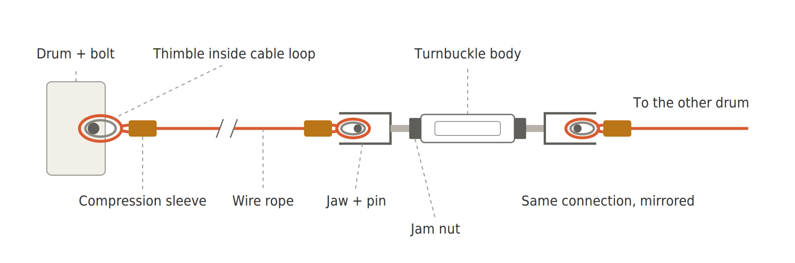

Cable steering layout on our frame

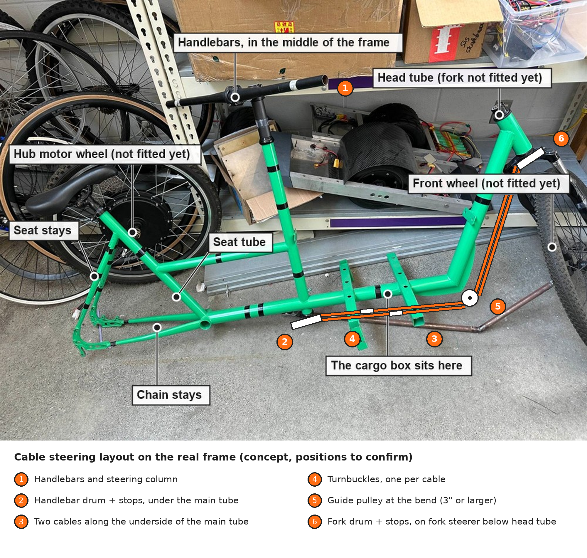

## Thumb throttle

From [Joe's research doc](https://docs.google.com/document/d/1CcL8Wi5o5KwVYpuwYVhihN6EKA5CEtITez-HQJVLsqY/edit) for [#39](https://github.com/Electrium-Mobility/Bakfiets-F26/issues/39).

Throttle power and signal to the controller

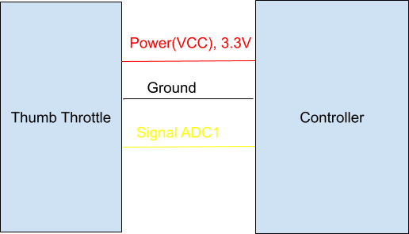

## VESC Tool setup

From [David's research doc](https://docs.google.com/document/d/1j8MdOX_X7YmgLBL9RPZFvX0nbanl0cpTKmFx9X2taN4/edit).

The VESC Tool 7.00 download

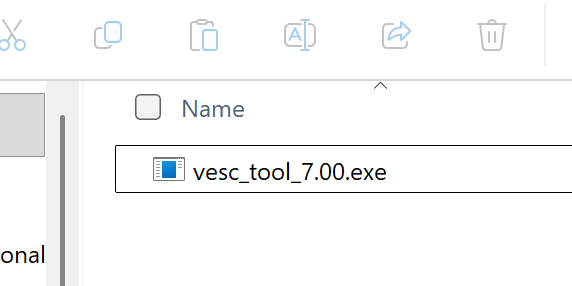

VESC Tool welcome screen

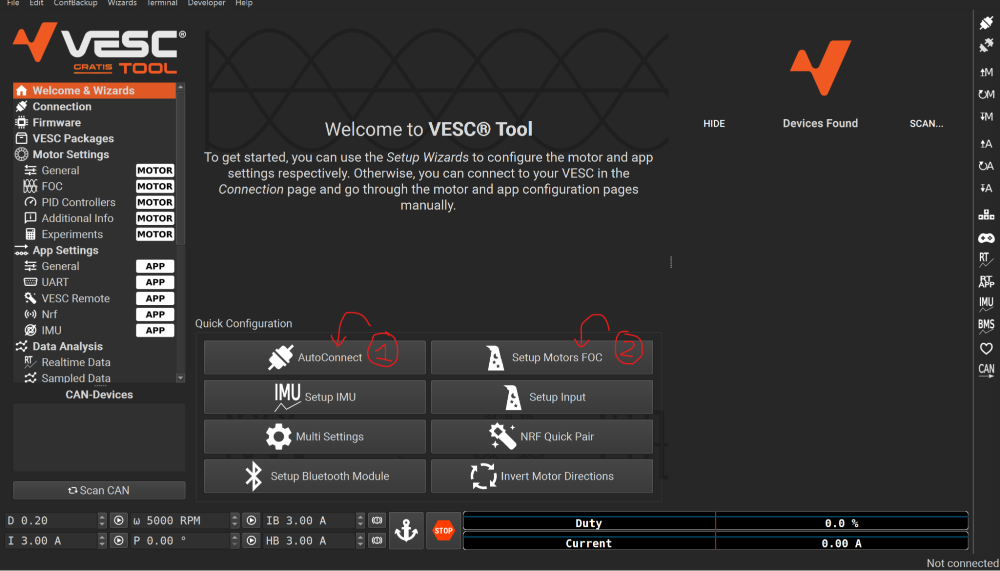

Where Motor Settings General is

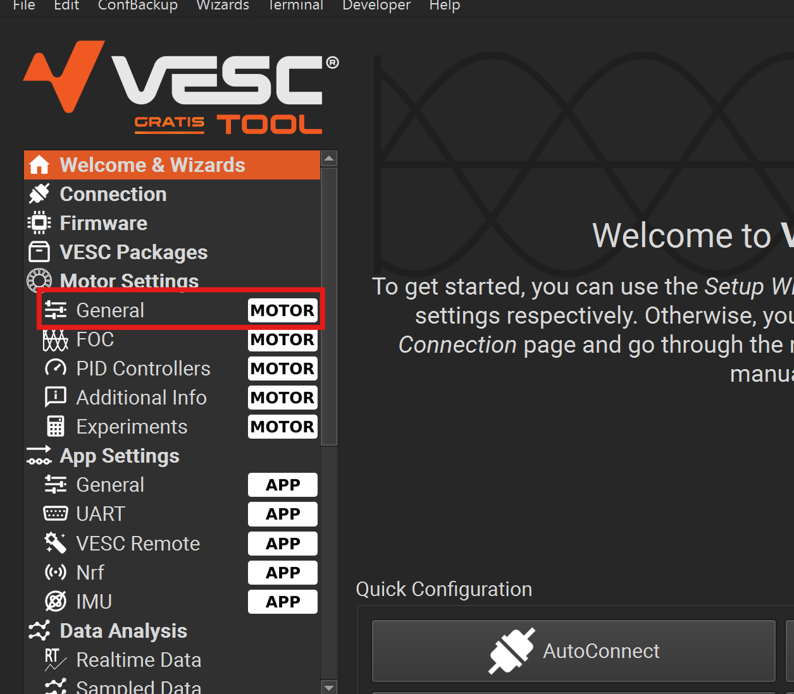

Toolbar button for reading the motor configuration

