# New steering for the Bakfiets

This is a proposed fix for the steering problems on [#25](https://github.com/Electrium-Mobility/Bakfiets-F26/issues/25). Treat it as a draft for the people on that issue and the mechanical leads to check.

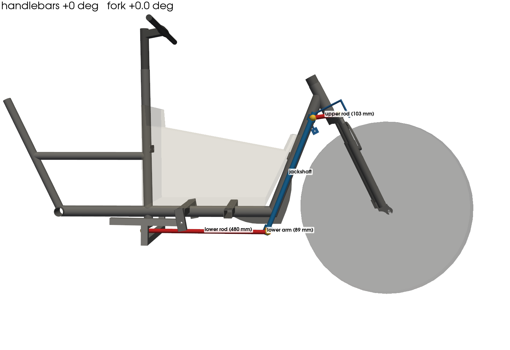

Red parts are rods, blue is the turning shaft, orange parts are arms and yellow balls are ball joints. The box and wheel are see-through so you can see what's behind them.

## The problem

The handlebars are at the back of the cargo box and the fork is at the front. A straight rod between them would go through the box, so the rod we have is bent to go under the box and then up.

Each end of the rod sits in a ball joint, so the rod can spin around the yellow line between the two balls. A straight rod spinning on that line wouldn't matter. Ours has its bend 220 mm away from the line, so the middle of the rod swings around and the rod flexes every time you turn the handlebars. That's the play you feel.

Nothing stops the handlebars from turning too far either. In the CAD the steering jams after 50° to the left, and to the right it keeps turning until the wheel goes sideways. That matches the problems listed on #25.

## The fix

Split the bent rod into two straight rods, with a short turning shaft at the corner where the bend was.

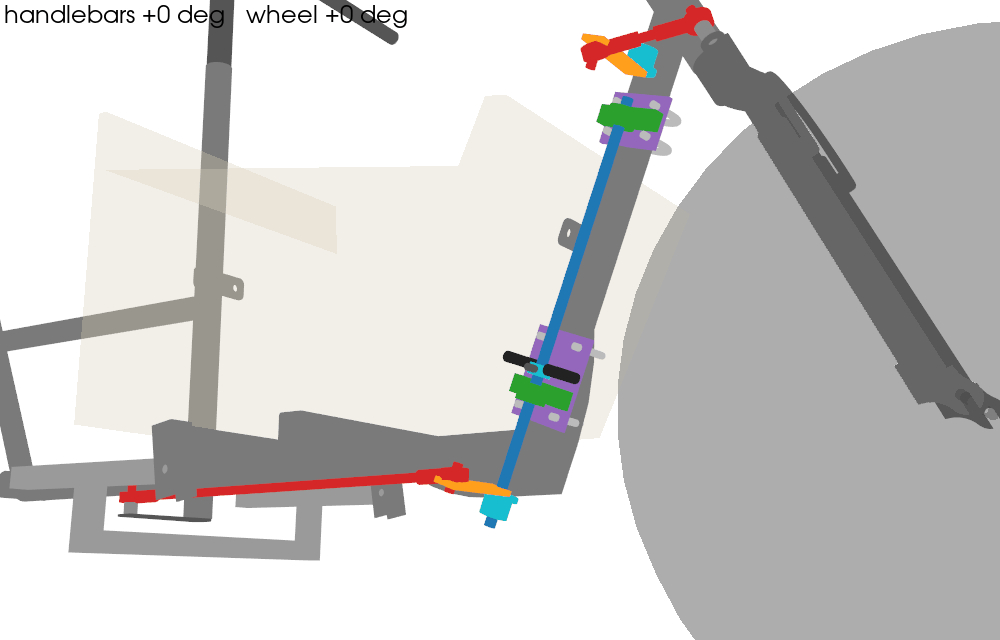

Here's what happens when you turn the handlebars:

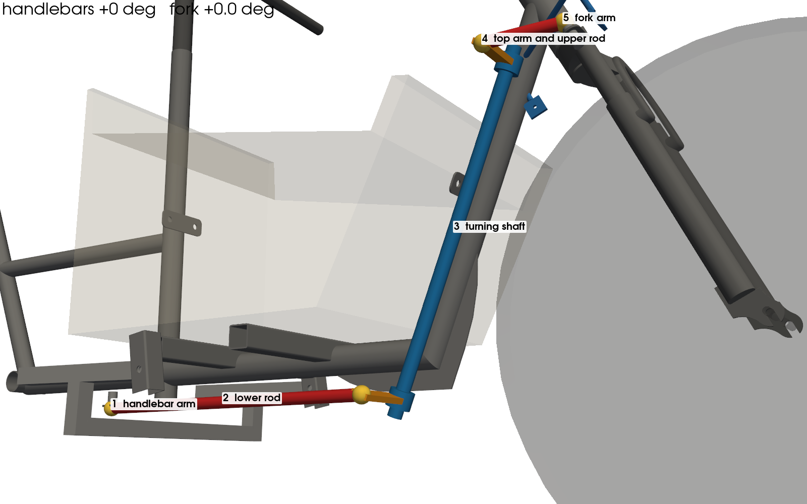

1. The handlebar arm swings. It's the arm we already have.
2. It pushes the lower rod, which runs flat under the box.
3. The lower rod turns the shaft. The shaft sits beside the front frame tube, held by two clamps.
4. An arm at the top of the shaft pushes the short upper rod.
5. The upper rod pushes the fork arm, which we also already have, and the wheel turns.

Both rods are straight, so they can't flex or swing around. Stops hold the handlebars to 35° each way, well before anything can jam.

## More views

| From the front and right | From behind and above |
| --- | --- |
| 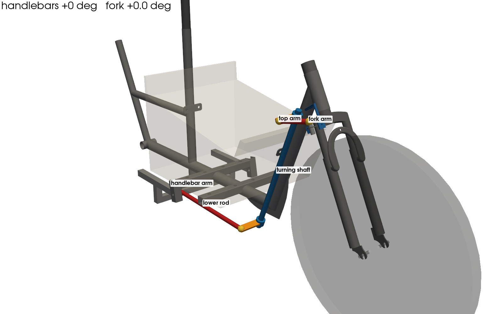 | 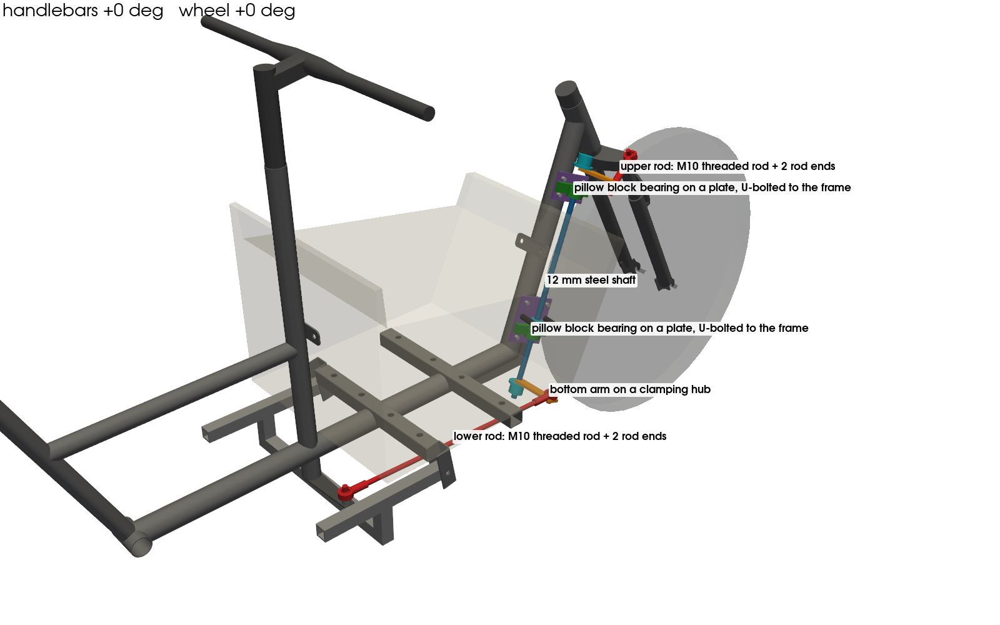 |

| From the front | From underneath |
| --- | --- |
| 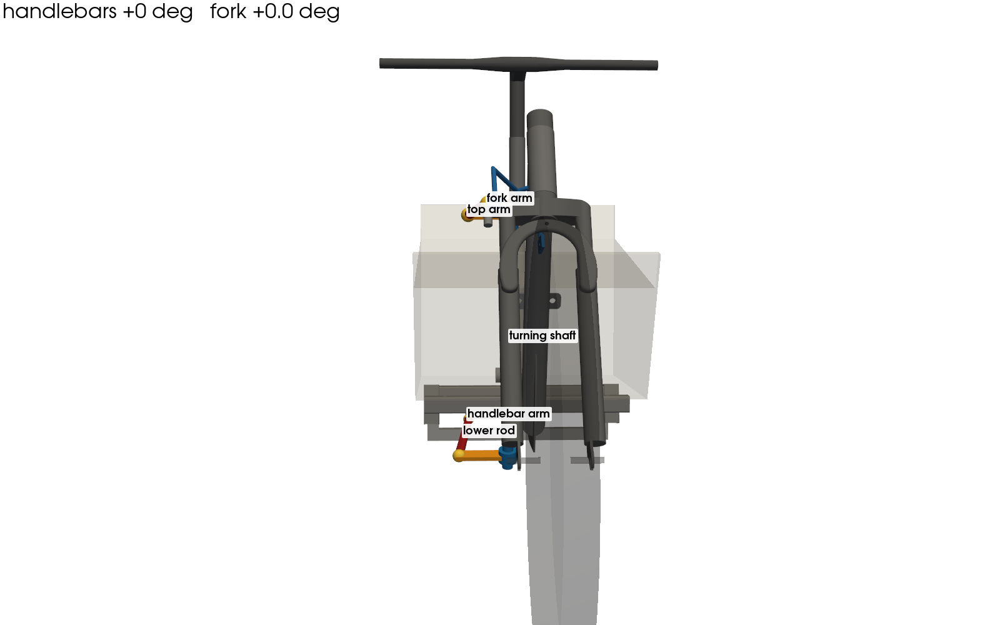 | 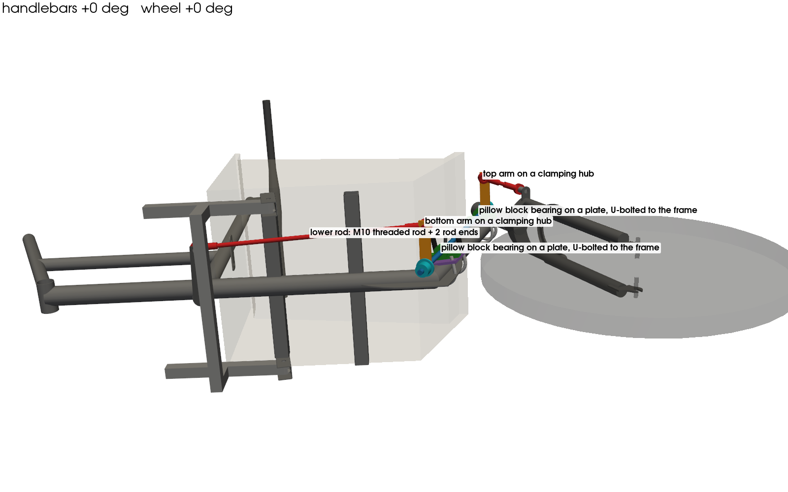 |

| Top joint | Bottom joint |
| --- | --- |
| 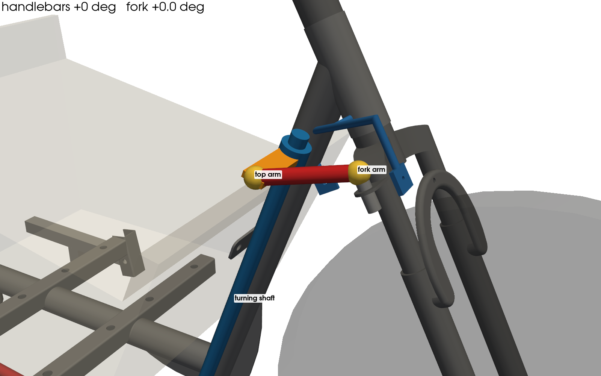 | 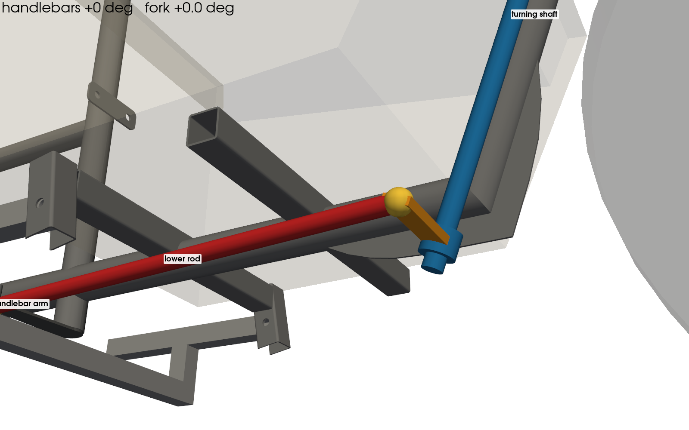 |

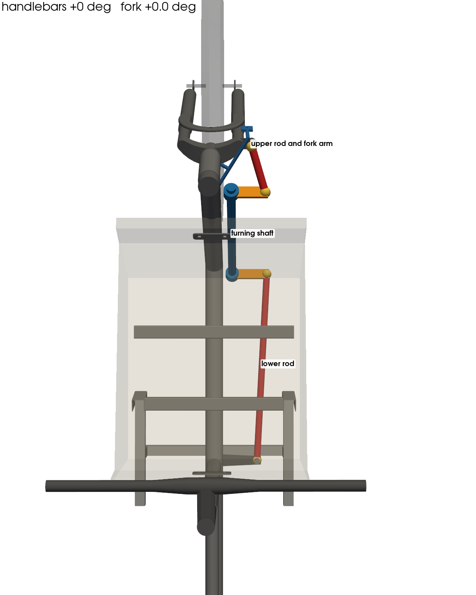

## The new parts

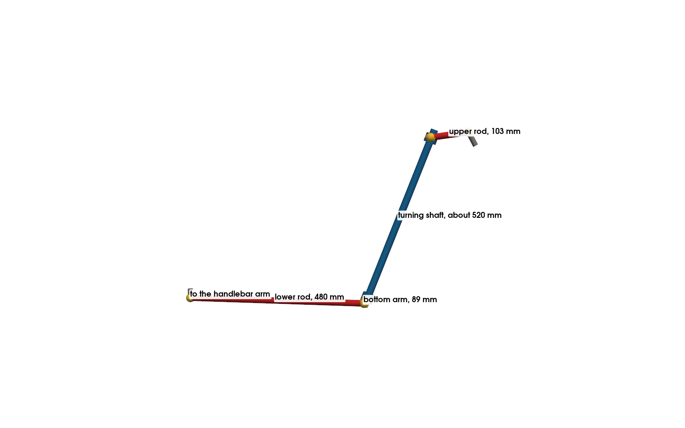

| Part | Size |
| --- | --- |
| Turning shaft | About 520 mm long. It runs alongside the front frame tube at the same angle, 45 mm to the right of the tube's centre |
| Bottom arm | Flat bar at the bottom of the shaft, pointing right. 89 mm from the shaft to the ball joint |
| Top arm | Flat bar near the top of the shaft, pointing right. 74.5 mm from the shaft to the ball joint |
| Lower rod | 480 mm between ball joint centres |
| Upper rod | 103 mm between ball joint centres |
| Ball joints | Two new ones, the same size as the two we have |
| Spacers | A 25 mm spacer moves the handlebar ball joint down, so the lower rod passes under a bracket on the box. A 40 mm spacer moves the fork ball joint up, so the upper rod misses the top of the fork |
| Stops | Handlebars stop at 35° each way |

## How well it steers

The wheel turns almost as far as the handlebars. The gap grows a little near the stops, but stays under 5°.

| Handlebars | Wheel |
| --- | --- |
| 35° left | 30° left |
| 20° left | 18° left |
| Straight | Straight |
| 20° right | 20° right |
| 35° right | 39° right |

## Does anything hit?

I turned the real wheel and fork from the CAD through the whole range and measured the gap between every new part and the bike. The closest are below. Everything else has at least 30 mm.

| What | Closest gap | When |
| --- | --- | --- |
| Upper rod and top of the fork | 7 mm | Full left |
| Lower rod and kickstand | 9 mm | Slightly right |
| Top arm and frame | 9 mm | Full right |
| Shaft and frame tube | 13 mm | Full left |
| Shaft and cargo box | 14 mm | Full left |

| Full left | Full right |
| --- | --- |
| 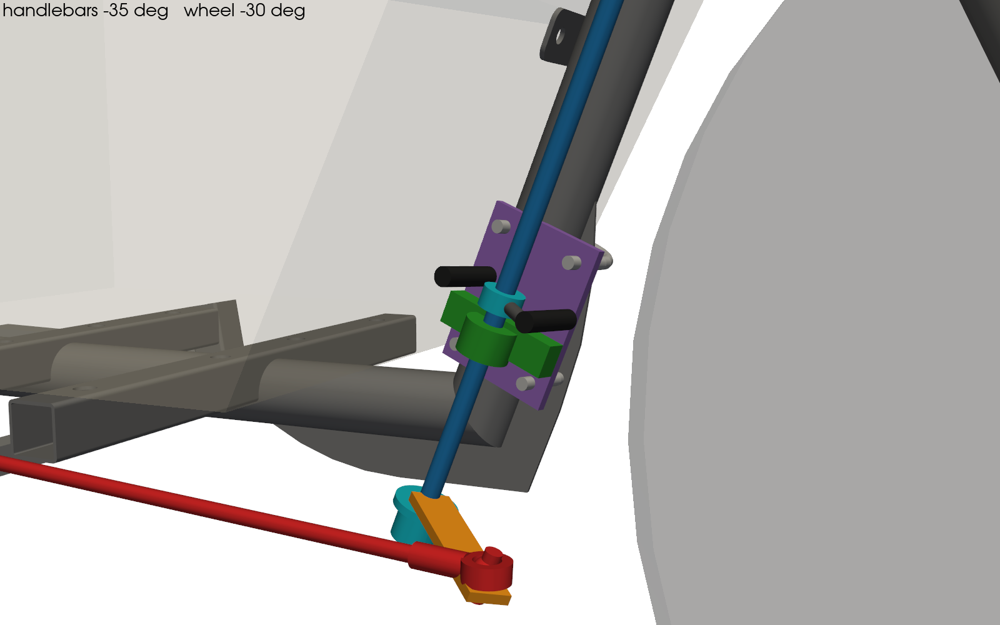 | 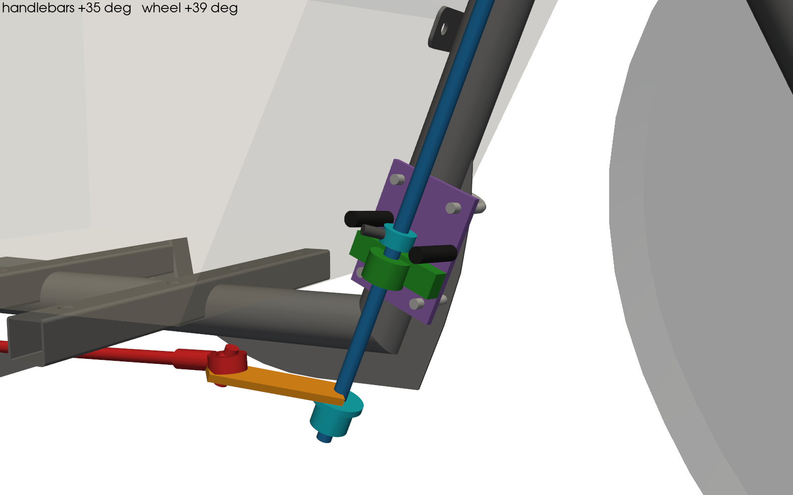 |

## Before building

- All of this comes from the CAD. Check the real bike first, mainly the angle of the front frame tube and where the front of the box sits.
- The shaft passes about 13 mm from the frame tube, so whatever holds it has to be small. A 12 mm shaft in bronze bushings fits.
- The 40 mm spacer puts a lot of sideways load on its bolt. Use an M10 bolt, grade 8.8, with a steel tube as the spacer, or make a new fork arm with the ball joint higher up.
- The shaft clamps and the stops still need designing. Nobody has checked yet whether the lower rod is near the rider's feet.
- Any change to the frame needs a mechanical lead and the project lead to sign off, the same as on the [brakes page](../brakes/README.md#limits).

## Building it in SolidWorks

The parts are simple shapes, so they can be drawn from the table above. The file [`jackshaft_parts.step`](../../mechanical/steering-sim/jackshaft_parts.step) has them already in place on the bike, which helps as a guide.

To make the assembly turn when you drag the handlebars:

- Give the shaft, the handlebar post and the fork a concentric mate with the tube they sit in, so they can only turn.
- At both ends of a rod, make the centre of its ball coincident with the centre of the ball on the arm.
- Add an angle limit of 35° each way on the handlebars.

Then turn on *Collision Detection* while dragging to check the same gaps as the table above.

## How this was worked out

I exported the 11 Nov assembly (`mechanical/cad-2026/f26bakfiets_main_asm.SLDASM`) from SolidWorks and loaded it in a Python CAD library called build123d. A program then tried thousands of shaft positions and arm lengths, and kept the one where the wheel follows the handlebars most closely. A second program turned the real bike parts through every angle to check the gaps. The code and instructions for running it again are in [`mechanical/steering-sim`](../../mechanical/steering-sim/README.md).
