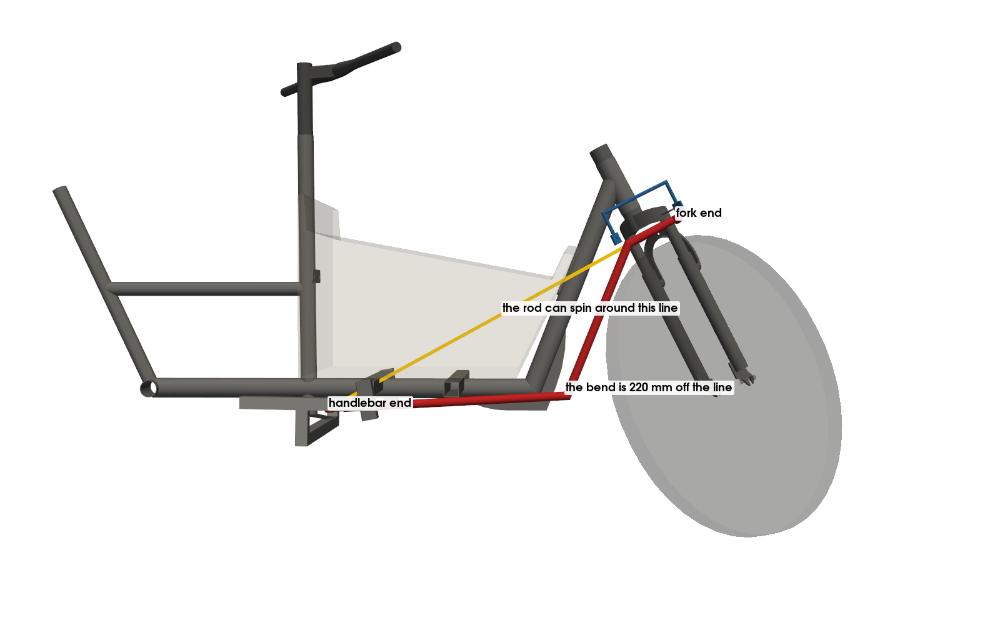
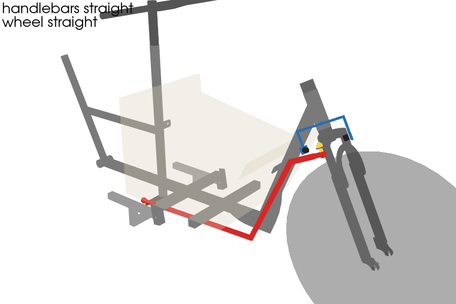
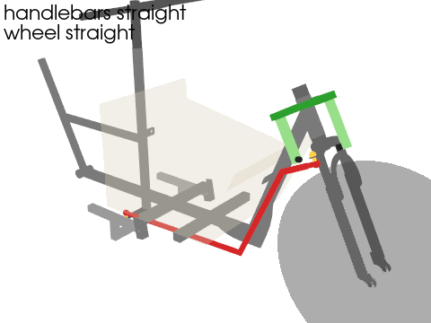
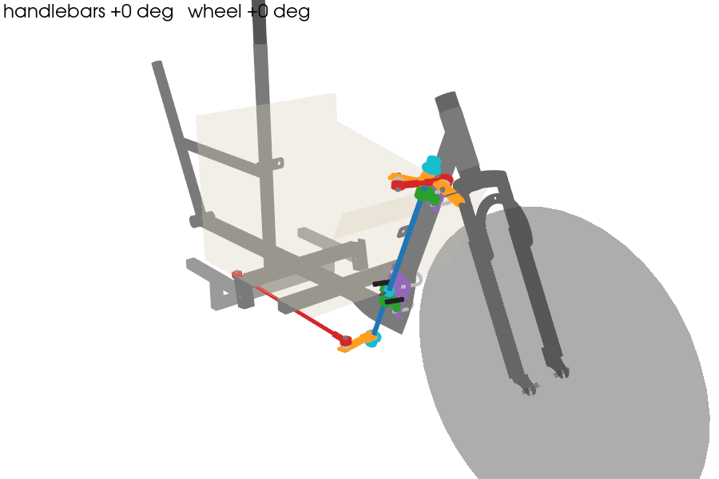
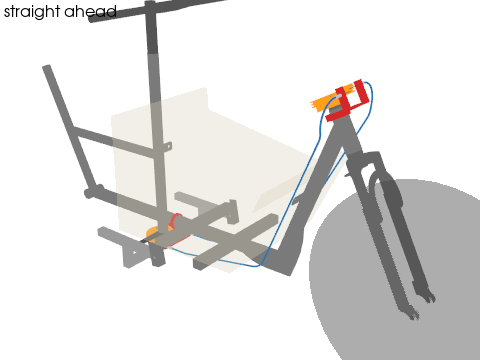
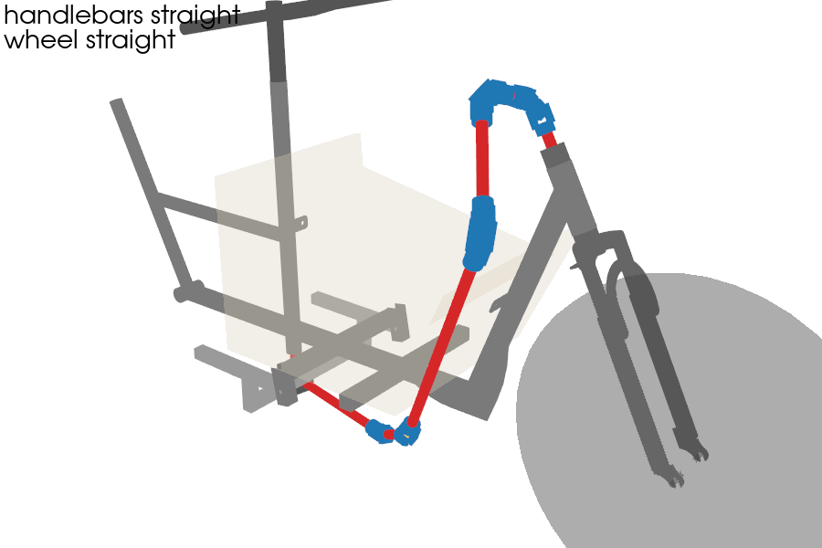

# Steering for the Bakfiets

These pages cover the steering work for [#25](https://github.com/Electrium-Mobility/Bakfiets-F26/issues/25). Four designs were modelled on the 11 Nov CAD and checked against the frame, cargo box, kickstand, wheel and fork through a full turn. None of them has been built.

## The problem

The handlebars sit behind the cargo box and the fork sits in front of it. A straight rod between them would pass through the box, so the rod on the bike bends to go under the box and then up.

Both ends of the rod sit in ball joints, so the rod spins freely around the yellow line between the two balls. Its bend sits 220 mm off this line. The middle of the rod swings around and the rod flexes every time you turn the handlebars, and you feel this as play.

The bike also has no steering stop. The CAD shows a welded strip with two rubber bumpers on the head tube, but the strip exists only in the CAD.

## The designs

| Design | What changes | Where it stands |
| --- | --- | --- |
| [Stopper for the bent rod](stopper/README.md) | Keeps the bent rod and adds a milled aluminium stop on the head tube | Drawings ready. Measure the bike, then print a test fit |
| [Jackshaft](jackshaft/README.md) | Two straight rods and a short turning shaft beside the front frame tube | Modelled and checked. The arms need a cleaner shape before building |
| [Cable](cable/README.md) | Two discs joined by two brake cables, as on the Trek Fetch+ 4 | Modelled, checked and ready to print. Cable tension still needs a figure |
| [U-joint shafts](u-joint/README.md) | Shafts and U-joints from the handlebar post to the fork | Fails as drawn. The joints would need to bend far past their rating |

| Stopper for the bent rod | Jackshaft |
| --- | --- |
|  |  |

| Cable | U-joint shafts |
| --- | --- |
|  |  |

The stopper limits how far the steering turns and leaves the flex in the rod. The jackshaft and the cable fix both problems.

## Before you build any of them

- The CAD differs from the bike near the head tube. The welded strip exists only in the CAD. To keep the bent rod, lengthen the one on the bike by welding on a piece of rod, or make a new one.
- Measure the head tube, the fork steerer and the main tube on the bike. Every design here takes its sizes from the CAD.

## Code and CAD files

The code behind every design, with instructions for running it again, is in [`mechanical/steering-sim`](../../mechanical/steering-sim/README.md). The STEP files there open in SolidWorks and use the same coordinates as the main bike assembly.
