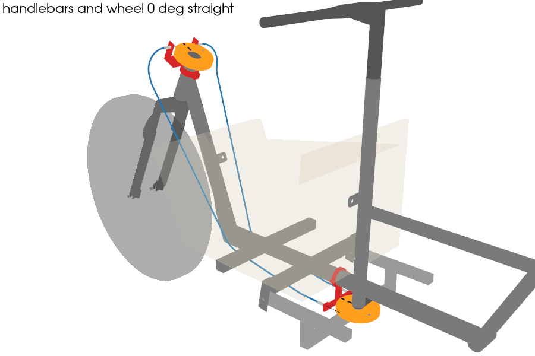
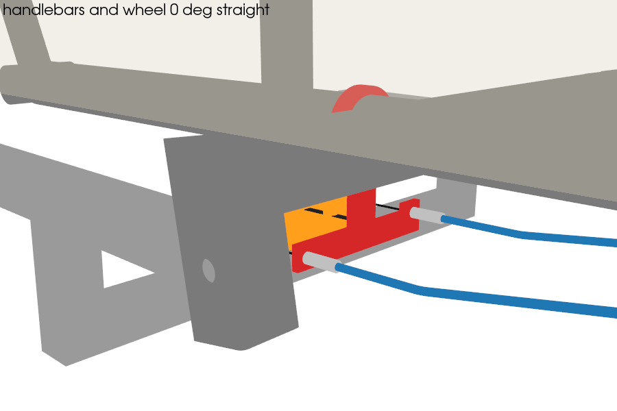
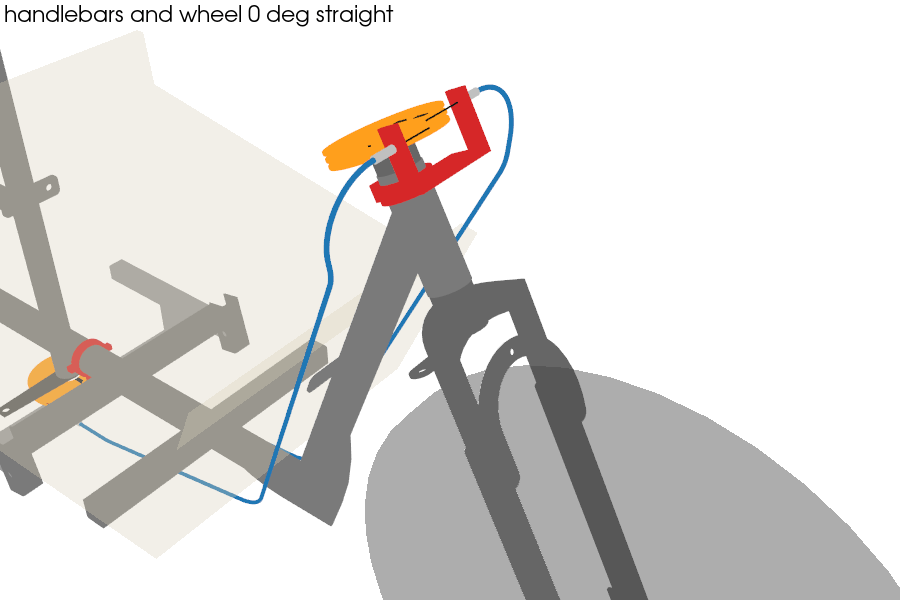
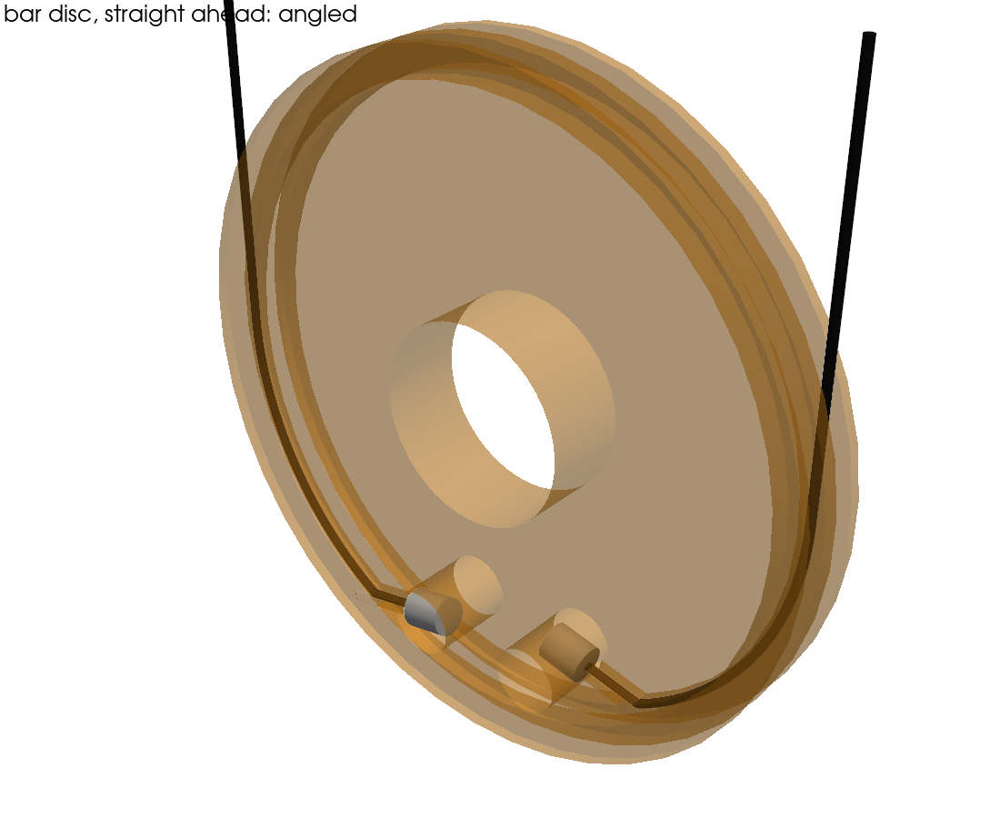
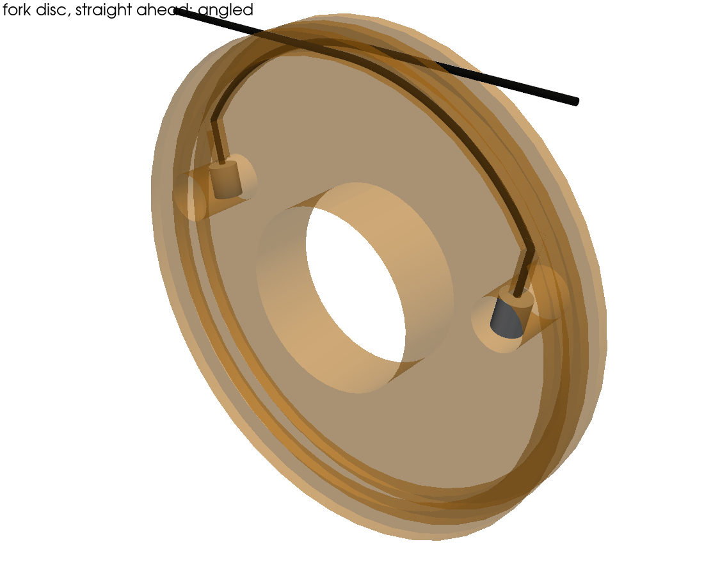
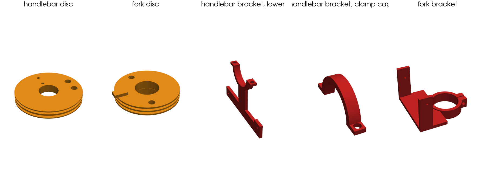

# Cable steering

[Back to the steering overview](../README.md)

This copies the layout of the Trek Fetch+ 4 and the Decathlon F900E. A disc with two grooves sits under the handlebar post, and a second disc sits on top of the fork steerer. Two steel brake cables in brake housing join the discs. Turning the handlebars right winds the right cable onto the handlebar disc, and the cable pulls the fork disc round by the same angle. Both discs have the same size, so the wheel turns as far as the handlebars.

| Handlebar end | Fork end |
| --- | --- |
|  |  |

In the pictures, orange is the discs, red is the brackets and blue is the cable housing.

## How it works

- Both discs have a radius of 60 mm, with the cables running in grooves 55 mm from the centre. The left cable uses the upper groove on both discs, and the right cable uses the lower one. The cables never cross.
- The handlebar disc bolts under the existing handlebar arm. Its cables leave its left and right edges heading forward, into a stop plate hung from a clamp on the main tube.
- The fork disc clamps onto the steerer above the head tube. Its cables leave its front edge sideways, into two uprights on a clamp ring around the head tube.
- The housings run under the main tube, climb in front of the cargo box and turn in to the stops beside the head tube. Both are about 1.1 m long, with no bend tighter than 60 mm.
- A tab on top of the fork disc meets the fork bracket uprights with the steering turned 37.5° to either side. This is the steering stop. Past 60° a cable comes off its disc, so the stop matters.

| Handlebar disc | Fork disc |
| --- | --- |
|  |  |

One end of a cable keeps its factory nipple, and the other end gets a screw-on nipple after cutting to length. The nipples sit in 12 mm holes through the discs. In a full turn the cable keeps 25° wrapped on its disc.

## Measure first

Every printed part takes its size from the CAD. Check these on the bike with calipers before printing. If a number differs from the CAD by more than 0.3 mm, change it in `cable.py` and export the STL files again.

| What to measure | CAD value | Printed part it sets |
| --- | --- | --- |
| Fork steerer outside diameter, just above the headset | 43.8 mm | Fork disc bore |
| Steerer length above the top of the head tube | ends about 40 mm above it | Fork disc height. The disc must sit fully on the steerer |
| Head tube outside diameter | 46.1 mm | Fork bracket clamp |
| Main tube outside diameter, 60 to 80 mm in front of the handlebar post | 44.4 mm | Handlebar bracket clamp |
| Handlebar post outside diameter, below the arm | 33.8 mm | Handlebar disc bore |
| Gap from the underside of the handlebar arm to the kickstand cross member | 19.1 mm | Handlebar disc thickness (15 mm) |

Also check whether the kickstand moves when it folds. The handlebar disc clears it by about 2 mm.

## Print list

The five STL files are in [`print`](print). Every mesh is closed and manifold. Together they take about 510 g of filament with full infill.

| File | How many | Size (mm) | Mass, PETG with full infill | How it prints |
| --- | --- | --- | --- | --- |
| `handlebar-disc.stl` | 1 | 120 x 120 x 15 | about 170 g | Flat. The groove undersides bridge 5.8 mm |
| `fork-disc.stl` | 1 | 125 x 120 x 39 | about 227 g | Hub down, supports under the disc rim |
| `fork-bracket.stl` | 1 | 106 x 100 x 74 | about 75 g | Base plate flat on the bed, uprights standing |
| `handlebar-bracket-lower.stl` | 1 | 10 x 126 x 81 | about 26 g | On its large flat face, supports under the half ring |
| `handlebar-bracket-clamp-cap.stl` | 1 | 10 x 72 x 28 | about 6 g | On its large flat face |

- Use PETG, ASA or nylon. Carbon-filled nylon is the stiffest. PLA creeps under the constant cable pull and softens around 55 °C.
- Print the discs and the fork bracket with full infill, or with 6 or more walls and 50% gyroid infill. The cable grooves and the bolt holes carry the load.
- Use 0.2 mm layers. Drill or ream the bolt holes to size after printing: 5.5 mm (M5) on the handlebar disc, 6.4 mm (M6) on the clamps.
- Print one disc first and check your nipples fit the 12 mm anchor holes.

## Buy list

About CAD 160 in total.

| Part | How many | Where | About, CAD |
| --- | --- | --- | --- |
| Stainless brake inner cable, 1.5 mm x 3500 mm (tandem length), barrel nipple end | 2 (one spare) | Bike shop, or Jagwire online | 40 |
| 5 mm brake housing, 2.5 m or more | 1 | Jagwire Universal Sport XL kit, or bulk housing from a bike shop | 40 |
| 5 mm housing end ferrules | 4, plus spares | Bike shop | 5 |
| Inline barrel adjusters for 5 mm brake housing | 2 | Bike shop | 20 |
| Screw-on cable nipples, 7 mm across or less | 2 | Bike shop or online | 10 |
| Cable end crimps | 4 | Bike shop | 2 |
| M3 penny washers, 12 mm across, one under every ferrule | 4 | Hardware store | 3 |
| M5 x 30 socket bolts with nylon lock nuts, disc to handlebar arm | 2 | Hardware store | 4 |
| M5 washers, stacked to 2.3 mm between the disc and the arm | 6 | Hardware store | 2 |
| M6 x 30 socket bolts with nylon lock nuts and washers, fork disc hub and fork bracket | 3 | Hardware store | 6 |
| M6 x 20 socket bolts with nylon lock nuts and washers, handlebar bracket clamp | 2 | Hardware store | 4 |
| Medium-strength thread locker | 1 | Hardware store | 8 |
| PETG, ASA or nylon filament | 0.5 kg | Any filament supplier | 15 |

The handlebar arm needs two 5.5 mm holes drilled through it, on its centreline 25 mm and 45 mm from the post.

## Assembly and cable tension

Set the wheel and the handlebars straight ahead before fitting anything, and keep them there until both cables are tight.

1. Fit every printed part dry first, with no cables, to check the measurements.
2. Drill the two 5.5 mm holes in the handlebar arm. Bolt the handlebar disc under the arm with a 2.3 mm stack of M5 washers on both bolts, with thread locker.
3. Slide the fork disc onto the steerer, hub down, with the stop tab pointing straight forward. Tighten both M6 hub bolts.
4. Clamp the fork bracket ring around the head tube under the fork disc, slit to the back, uprights on both sides of the disc's front edge.
5. Clamp the handlebar bracket around the main tube, its stop plate just in front of the handlebar disc. The cap goes on top, with two M6 bolts.
6. Push the cable's free end into a handlebar disc anchor hole, out through the 2 mm slot and into the groove. Pull until the barrel nipple drops into the hole and seats against the slot end. Lay the cable in its groove round to the side of the disc, then forward through the stop plate.
7. On both stops, put an M3 penny washer against the plastic, then the ferrule, then the housing with its inline adjuster. Route the housing under the main tube, up in front of the cargo box and into the fork stop.
8. On the fork end, run the cable through the stop and round 60° of groove to the anchor slot. Push the end in through the slot from the groove side until it comes out in the anchor hole. Pull it hand tight, fit the screw-on nipple 5 mm past the slot, trim the tail and pull the cable back so the nipple seats in the hole. Do the second cable the same way.
9. Turn both inline adjusters out until the handlebars have no free play with the front wheel held. Tighten both by the same amount. If the handlebars sit off centre, turn one adjuster in and the other out by the same amount.
10. Crimp the cable ends and check every bolt is locked.

## Testing before riding

Ride only after every check below passes. The targets come from the EN 17860 cargo bike standard.

- No free play: hold the front wheel and rock the handlebars. Nothing should move before the wheel resists.
- Stiffness: clamp the front wheel, hang 10 kg from the handlebars 0.5 m from the steering axis (about 50 N·m) and measure how far the handlebars turn. Under 7° passes.
- Steering stop: turn fully to both sides. The stop tab on the fork disc should meet the fork bracket uprights near 37.5°, before anything else touches.
- Clearance: turn lock to lock slowly with the bike loaded and check nothing rubs, mainly the handlebar disc over the kickstand.
- Check again after two weeks and then monthly: play, cable tension, bolts, and any whitening or cracks in the printed parts.

Trek replaces all its steering cables every two years or 10,000 km. Plan to do the same.

## Does anything hit?

A program checked every new part against the frame, cargo box, kickstand, wheel, fork and handlebars, in 5° steps from 35° left to 35° right. No part touches another.

| What | Closest gap |
| --- | --- |
| Handlebar disc and kickstand | 2.1 mm |
| Disc spacers and frame | 3.8 mm |
| Housings and cargo box | 12.0 mm |
| Housings and frame | 27.1 mm |

## Still open

- Cable tension. The barrel adjusters pull the two cables tight against one another, and without tension the steering has play. The right tension depends on the force needed to turn the loaded front wheel, and this force needs measuring on the bike.
- Bracket stiffness. The stop brackets take the full cable pull, up to about 830 N in the stiffness test. A printed bracket bends under this, and the bending shows up as play. If the stiffness test fails, cut the same shapes from 5 mm aluminium plate.
- Clamp creep. Plastic clamps on the steerer and the tubes creep over months. Check the hub and clamp bolts, and move to a steel shaft collar on the steerer if the fork disc ever slips.
- Cable stretch. With one 1.5 mm cable per side and the far side slack, the handlebars turn about 8° under the 50 N·m test, just over the limit. With both cables tight, both carry load and the turn roughly halves. If the test still fails, run two cables per side, as Trek and Yuba do.
- Steerer length. In the CAD the steerer ends about 3.5 mm below the top of the fork disc. The steerer on the bike must reach the top of the disc, or the disc needs a spacer and top cap above it.

## Files

- [`cable_parts.step`](../../../mechanical/steering-sim/cable_parts.step) has the parts with the steering straight ahead, in the same coordinates as the main bike assembly.
- [`cable.py`](../../../mechanical/steering-sim/cable.py) builds every part. `export_prints.py` writes the STL files.

Sources: [Trek Fetch+ 4 service manual](https://www.manualslib.com/manual/3307778/Trek-FetchPlus-4.html) for the cable replacement interval, and the [EN 17860-2 preview](https://cdn.standards.iteh.ai/samples/74084/fe700371095846e1b77d6e3d35b2bd4e/SIST-EN-17860-2-2024.pdf) for the play, stop and stiffness rules.
