# Jackshaft steering

[Back to the steering overview](../README.md)

The bent rod becomes two straight rods, with a short turning shaft where the bend was. Every part is bought except two flat plates and two arms, which only need cutting, drilling and bending. Nothing gets welded, and the frame stays as it is.

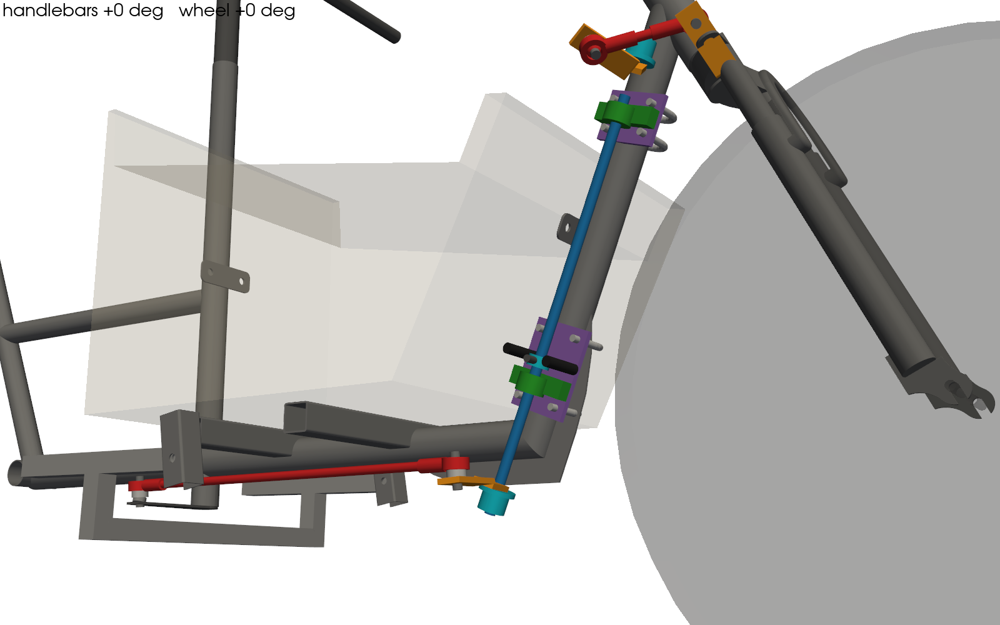

In the pictures, red is the rods and rod ends, blue is the turning shaft, green is the bearings, purple is the plates holding them, orange is the arms and black is the stops. The box and wheel are see-through so you see the parts behind them.

## How it works

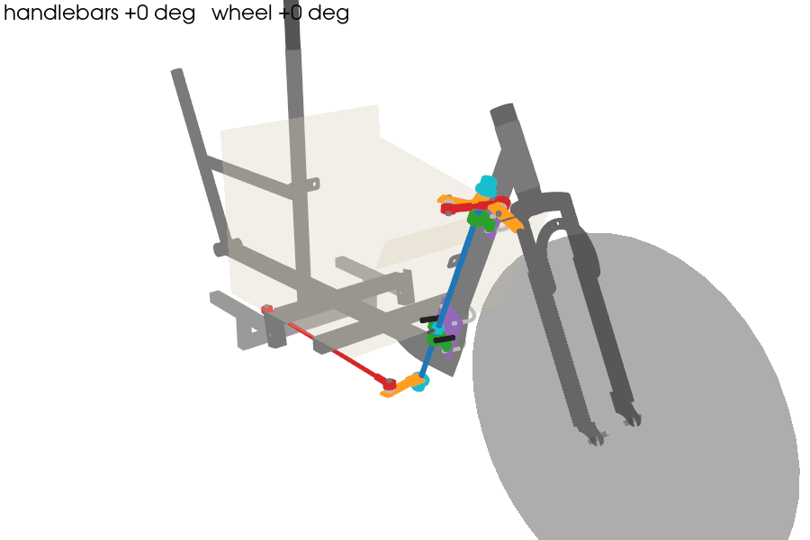

When you turn the handlebars:

1. The handlebar arm swings. The bike already has this arm.
2. It pushes the lower rod, which runs flat under the box.
3. The lower rod turns the shaft, which runs alongside the front frame tube in two bearings.
4. An arm near the top of the shaft pushes the short upper rod.
5. The upper rod pushes the arm on the fork, which the bike also already has, and the wheel turns.

Both rods are straight, so they push and pull without flexing. A stop on the shaft holds the handlebars to about 35° to either side.

## The rod end fix

The first version of this page, merged in [#83](https://github.com/Electrium-Mobility/Bakfiets-F26/pull/83), put every rod end bolt straight up. Through a full turn those rod ends needed up to 58° of swivel. Standard M10 rod ends swivel between 17° and 50°, depending on the type.

In this version, every rod end bolt sits square to the average direction of its rod, and the arm ends bend into tabs under the rod ends. The rod ends now swivel no more than 3.9°. The pictures on this page show this version.

The bent tabs work in the model but are awkward to make. A smoother arm needs a bend plus a 22.6° twist for the top arm, and a 48.5° wedge block under the fork end. Neither shape has been modelled yet.

## The joints

| Handlebar end | Bottom arm |
| --- | --- |
| 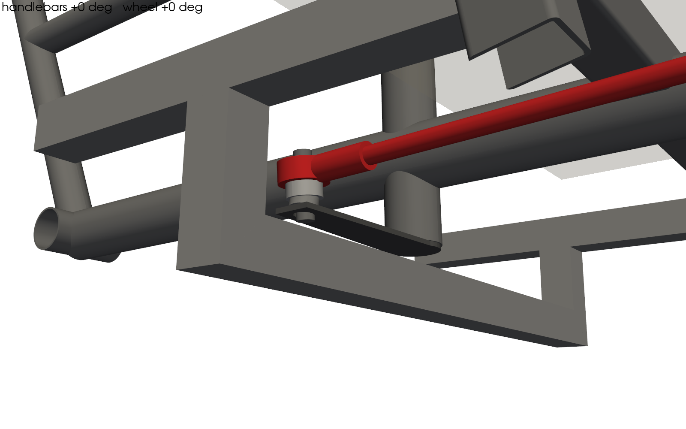 | 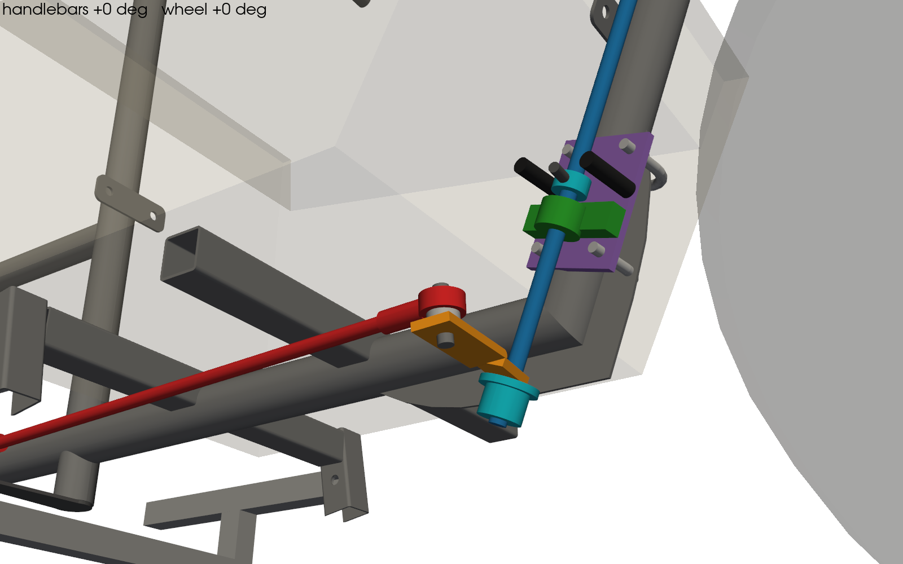 |

| Top arm and upper rod | Fork end |
| --- | --- |
| 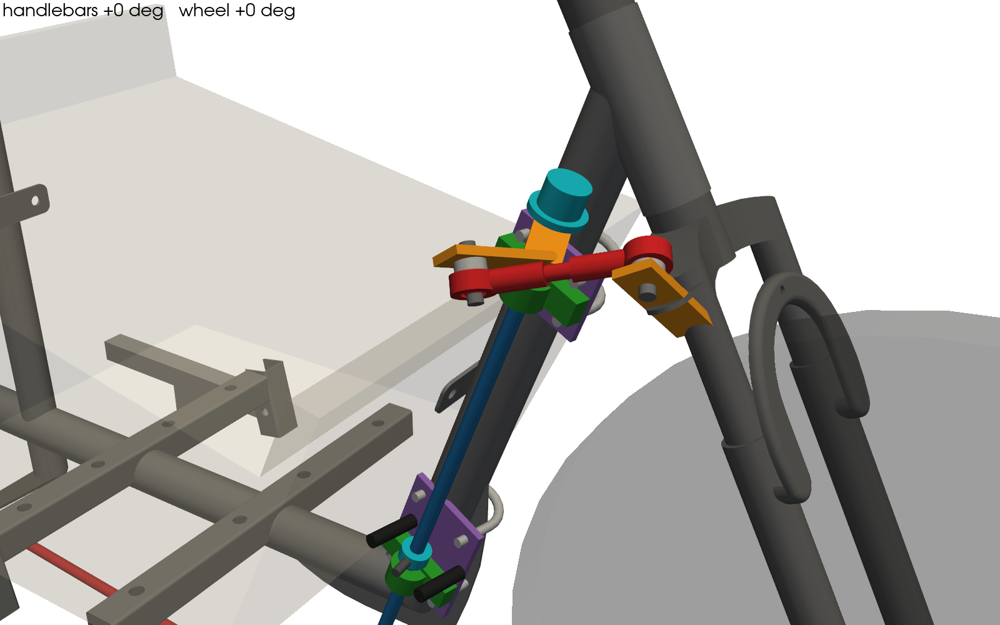 | 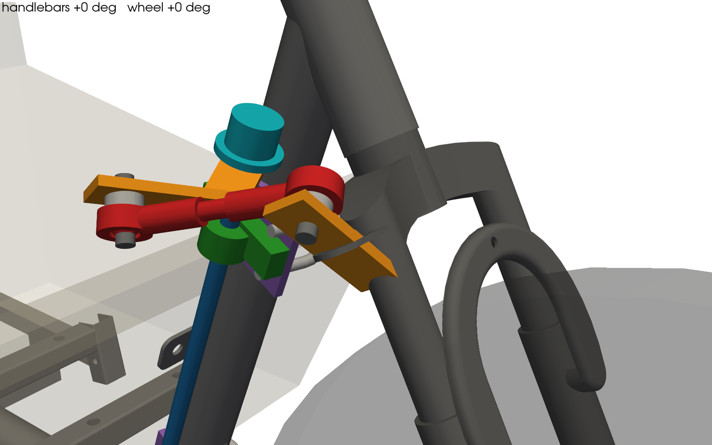 |

Both rods are M10 threaded rod with a rod end screwed onto both ends. A rod end is a ring with a swivel ball inside, and a bolt goes through the ball into the end of an arm. Turning a rod end on its thread changes the rod's length, and you set the wheel straight this way.

The two rod ends on the existing arms bolt through the holes the old ball joints used, on spacers. The handlebar spacer puts the ball where the old one was. The fork spacer lifts the ball 50 mm above the old one so the upper rod clears the top of the fork.

## The bearings and the stop

| Lower bearing and stop | Upper bearing |
| --- | --- |
| 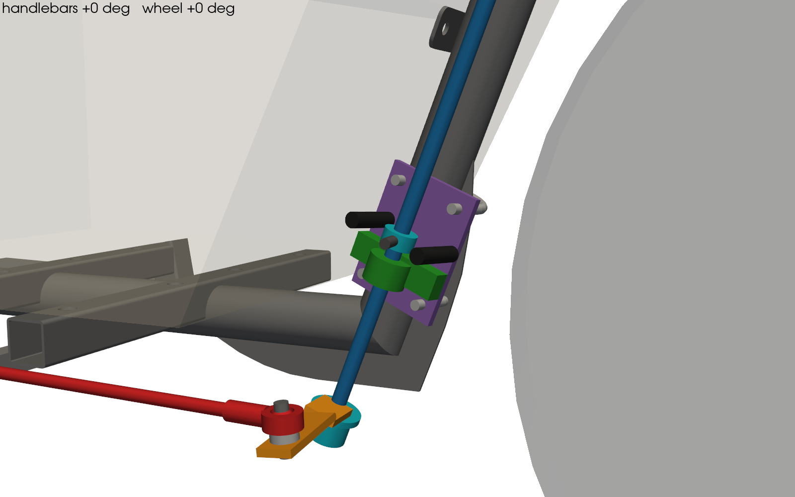 | 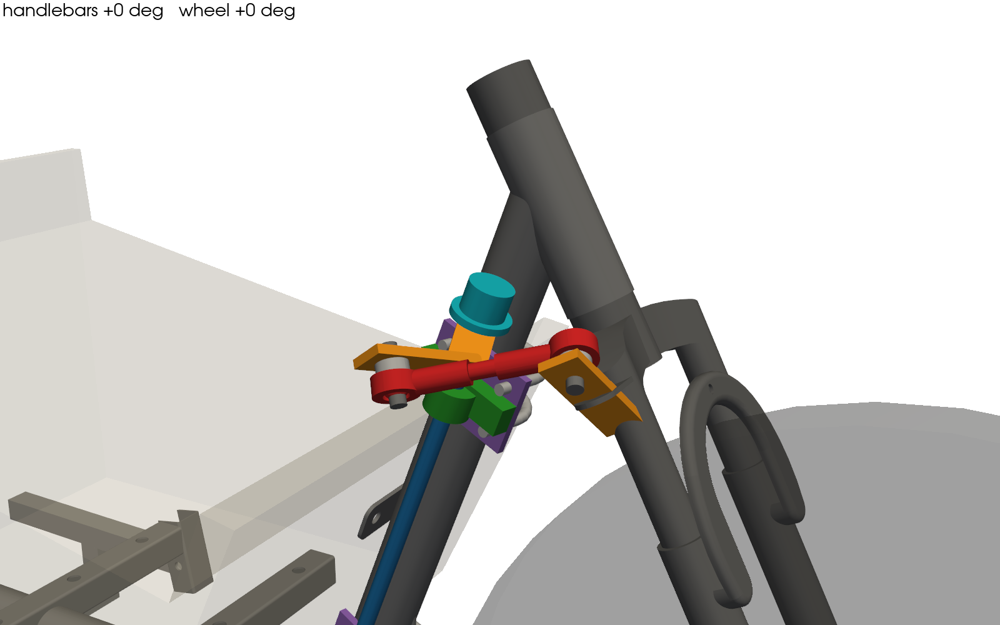 |

The shaft turns in two pillow block bearings. Both bolt onto a flat plate, and two U-bolts hold the plate against the side of the frame tube. In the middle of its height the front of the cargo box comes within about 35 mm of the frame tube. So one bearing sits low, just above the bend in the frame, and the other sits above the box, just under the top arm.

The stop is a shaft collar with a bolt sticking out of it. On full lock this bolt hits one of two bolts screwed into the lower plate. Both of those wear a rubber sleeve.

| Full left | Full right |
| --- | --- |
| 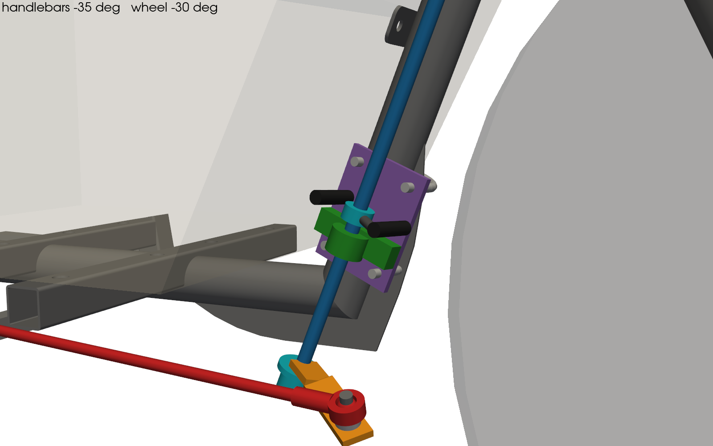 | 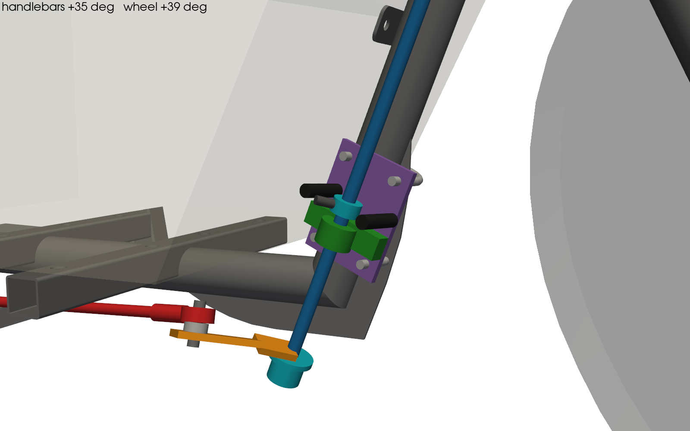 |

## More views

| From the right side | From the front and right |
| --- | --- |
| 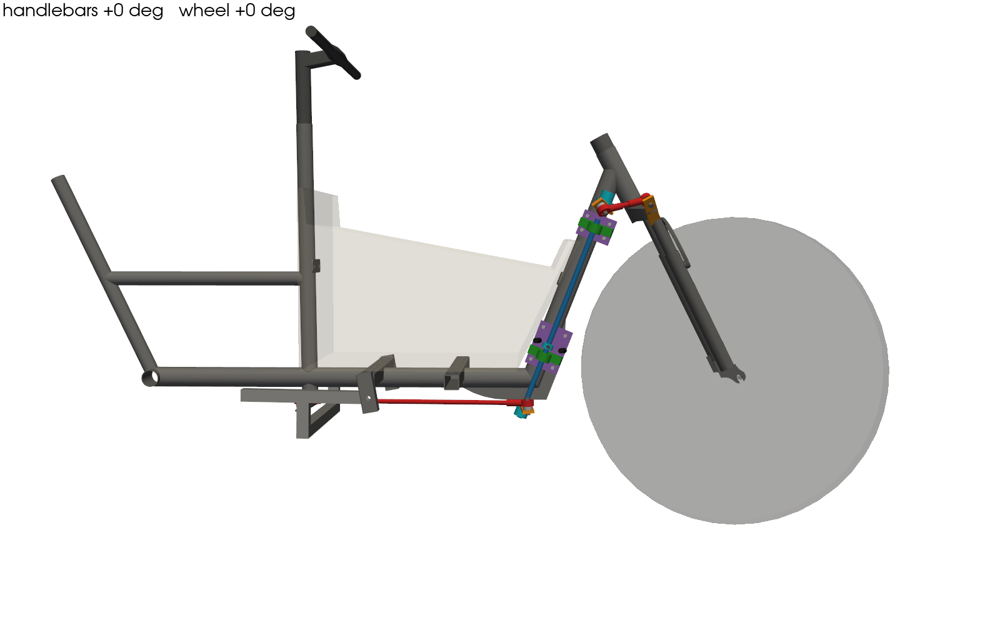 | 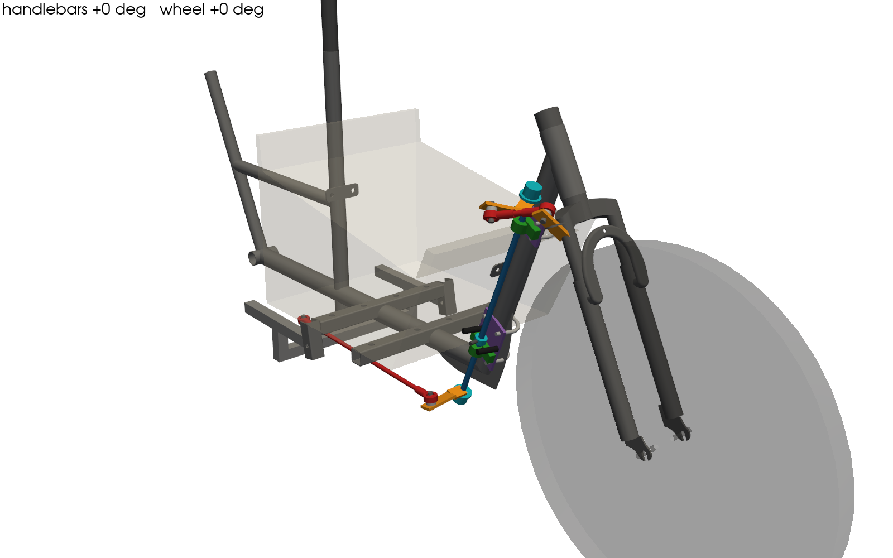 |

| From behind and above | From underneath |
| --- | --- |
| 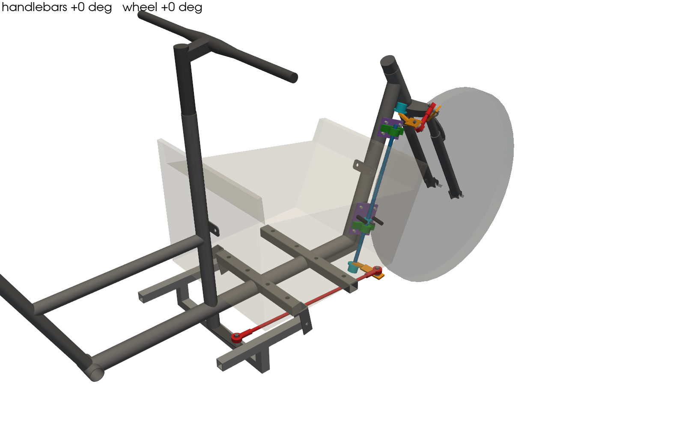 | 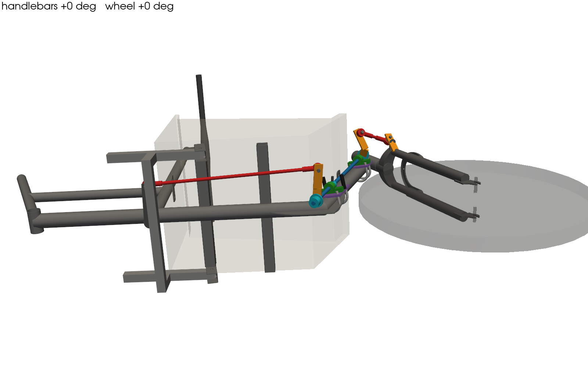 |

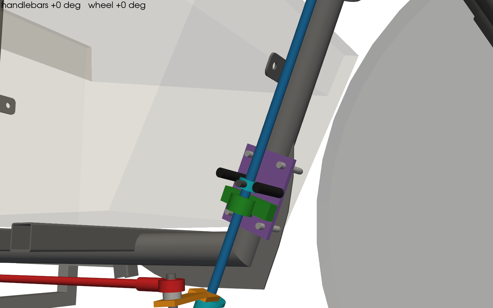

## Parts list

| Part | How many | Notes |
| --- | --- | --- |
| 12 mm steel shaft | 1 | Cut to about 500 mm |
| KP001 pillow block bearing, 12 mm bore | 2 | |
| 12 mm clamping hub with a flange | 2 | Holds the arms on the shaft. A small flange gives more room near the frame tube |
| Steel flat bar, 25 × 6 mm | About 250 mm | Two arms, drilled through both ends, with the ends bent into tabs |
| M10 rod end, female thread | 4 | Replaces the two old ball joints, plus two for the new arms |
| M10 threaded rod | About 450 mm | About 400 mm for the lower rod and a short piece for the upper rod |
| M10 nuts | 4 | Lock the rod ends once the length is set |
| M8 U-bolts for a 44.5 mm (1¾") tube | 4 | Two for both plates |
| Steel or aluminium plate, 6 mm | 2 | 76 mm wide, about 107 and 61 mm long. Cut and drill |
| 12 mm shaft collar with an M6 set screw hole | 1 | Swap the set screw for an M6 × 45 bolt. It becomes the stop pin |
| M8 × 50 bolts with rubber sleeves | 2 | Screw into the lower plate as the stops |
| Steel tube spacers | 2 | With longer bolts, under the rod ends on the existing arms |

[`jackshaft_parts.step`](../../../mechanical/steering-sim/jackshaft_parts.step) has all the new parts in place on the bike, to open in SolidWorks.

## How well it steers

The wheel turns almost as far as the handlebars. Near the stops the two drift apart, by less than 5°.

| Handlebars | Wheel |
| --- | --- |
| 35° left | 30° left |
| 20° left | 18° left |
| Straight | Straight |
| 20° right | 20° right |
| 35° right | 39° right |

## Does anything hit?

A program turned the wheel and fork from the CAD through the whole range in 5° steps and measured the gap between every new part and the bike. These are the closest.

| What | Closest gap | When |
| --- | --- | --- |
| Upper rod end and top arm | 2.4 mm | 35° right |
| Top arm's hub and frame tube | 3.1 mm | 25° left |
| Lower rod end and bottom arm | 5.2 mm | 35° left |
| Lower bearing plate and cargo box | 5.6 mm | All the time |
| Upper rod end and fork bracket | 5.6 mm | 5° right |
| Back stop bolt and cargo box | 6.6 mm | All the time |
| Lower bearing and cargo box | 7.5 mm | All the time |
| Lower rod and frame | 9.3 mm | 35° right |

Every other gap is 10 mm or more.

## Before building

- All of this comes from the CAD. Measure the bike first, mainly the angle of the front frame tube and where the front of the box sits. The plates and the back stop bolt have only 6 mm to spare.
- Redesign the bent tabs as smoother arms, then check the gaps again.
- Check the pillow block's centre height. The shaft sits about 46 mm from the frame tube's centre, so the plate plus the block's centre height has to come to about 24 mm.
- Check whether the lower rod comes near the rider's feet.

## Building it in SolidWorks

The parts are simple, so you draw them from the tables above, with `jackshaft_parts.step` open beside them for reference.

To make the assembly turn when you drag the handlebars:

- Give the shaft, the handlebar post and the fork a concentric mate with whatever they turn in, so they only turn.
- On both ends of a rod, make the centre of the rod end's ball coincident with the centre of its bolt hole in the arm.
- Add an angle limit of 35° to either side on the handlebars, or model the stop pin and bolts.

Then turn on *Collision Detection* while dragging to check the same gaps as the table above.

## How this was worked out

The 11 Nov assembly (`mechanical/cad-2026/f26bakfiets_main_asm.SLDASM`) was exported from SolidWorks and loaded into a Python CAD library called build123d. One program tried thousands of shaft positions and arm lengths, and kept the layout where the wheel follows the handlebars most closely. A second one turned the bike parts through every angle to check the gaps, and a third placed the bought parts and the stop. The code is in [`mechanical/steering-sim`](../../../mechanical/steering-sim/README.md).
