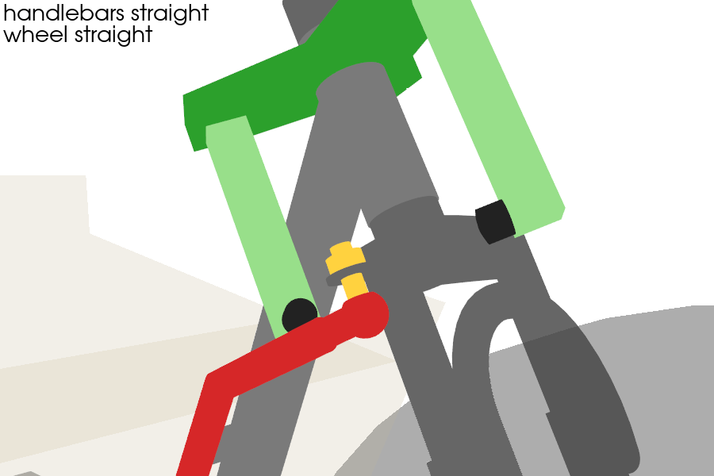
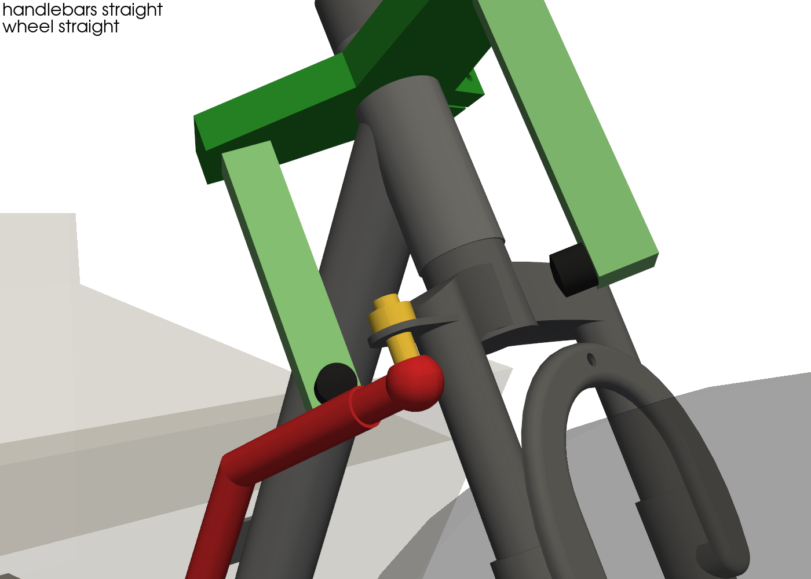
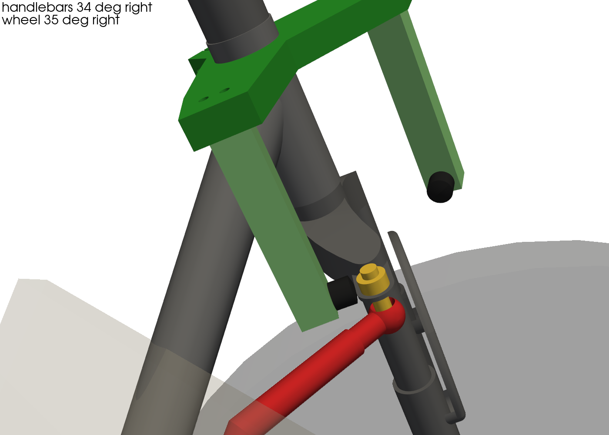
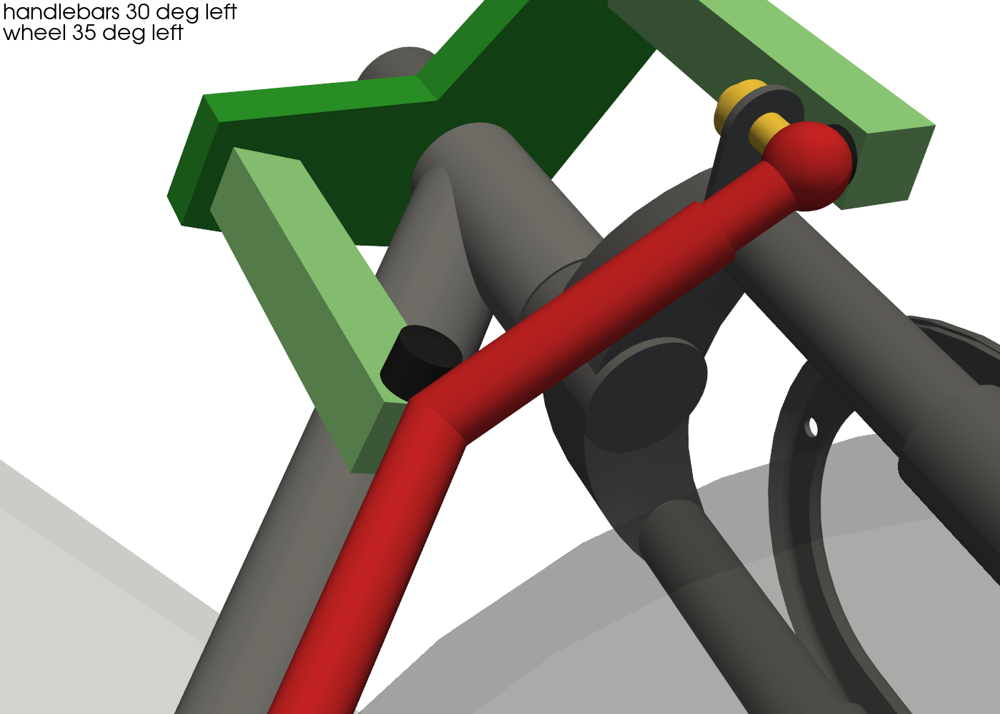

# Stopper for the bent rod

[Back to the steering overview](../README.md)

This keeps the steering as built: one bent rod with a ball joint on both ends, from the handlebar arm to the fork arm. It adds a steering stop made from three machined aluminium parts. The fork arm meets a rubber bumper with the fork turned 35° to either side, and the handlebars then sit about 34° right or 30° left.

The bent rod still flexes, because its bend sits 220 mm off the line between its two ball joints. The [jackshaft](../jackshaft/README.md) and the [cable](../cable/README.md) designs fix the flex. This stopper only limits how far the steering turns.

In the pictures, dark green is the clamp block, light green is the two stop bars, black is the bumpers and red is the bent rod.

## The parts

A clamp block grips the head tube 13 mm below its top. Two square bars hang from the block, one on both sides of the fork arm, and a rubber bumper screws into both bars near their lower ends.

| Straight ahead | Full right |
| --- | --- |
|  |  |

Made parts, all 6061 aluminium:

- Clamp block, from 20 mm plate, 0.6 kg. It has two straight arms, a bore for the head tube, a slit closed by two M6 bolts and a square pocket under the end of both arms. Milled.
- Two stop bars, from 1 in square bar: 152.4 mm (bar A, front) and 150.0 mm (bar B, rear), 0.26 kg apiece. Sawn, then drilled and tapped M6 in three places.

Bought parts:

- 4 M6 x 25 and 2 M6 x 30 socket cap bolts, class 8.8, with washers
- 2 McMaster 9546K431 rubber bumpers

[`stopper-drawings.pdf`](stopper-drawings.pdf) has three sheets. Sheet 1 gives every corner, hole and pocket of the block as a position from the bore centre, for a mill with a readout or a CNC. Sheet 2 has the bars. Sheet 3 has the hardware, bolt torques and fitting notes.

## What was checked

- Every new part against the frame, cargo box, kickstand, wheel, fork, ball joint and rod, in 2.5° steps from 35° left to 35° right. No part touches another. The closest gap is 2.4 mm, from the rod to the rear bumper in a left turn of 30°. Spinning the rod about its ball joints keeps this gap between 2.4 and 2.6 mm.
- The block underside clears the down tube weld in the CAD by 1 mm.
- Strength, for a 100 N·m pull on the handlebars into a stop (330 N on a grip 0.3 m from the steering axis). The bars, bar bolts and block arms all hold twice this load or more. The clamp slips with about 145 N·m, 1.4 times the load. For comparison, a bike stem clamp on a 28.6 mm steerer slips with about 90 N·m.

The CAD shows a welded stopper strip on the head tube. The strip exists only in the CAD, so the bike has no steering stop today. The checks above leave the strip out.

## Fit and test steps

### Before you cut metal

1. Measure the head tube outside diameter with calipers, in two directions, 10 mm and 25 mm below its top. The model uses 46.1 mm. Bore the block to your reading plus 0.05 to 0.15 mm.
2. Find where the top headset cup ends inside the head tube. Use the headset maker's drawing, or look inside with the fork out. The block's top face sits 13 mm below the head tube top. The cup must end above this line, or the clamp squeezes the bearing.
3. Measure from the head tube top down to the top of the down tube weld. You need 34 mm or more. With less, the block sits on the weld, so ask about a thinner block before machining.
4. Check the space beside the head tube is clear. The bars hang on both sides of the fork arm, where the CAD shows the welded strip.
5. Print the block and both bars in PLA from the files in [`print`](print), and fit them on the head tube with the bumpers. Check the bore fit, the gap to the weld below and the steering feel. Turn the fork slowly to both sides. The fork arm should meet the bumper face flat, near 35°. With the handlebars turned fully left, slide a 2 mm drill bit between the rod and the rear bar and bumper. The model shows 2.4 mm. Ride the bike only once the metal parts replace the printed ones.

### On the bench, after machining

6. Put both bars in their pockets and tighten the bolts to 8 N·m. A 0.05 mm feeler gauge should not enter between a bar and the pocket floor.
7. Fit the two pinch bolts and tighten them to 6 N·m in turns. The slit should close evenly, with the same gap top and bottom.

### On the bike

8. Fit the block with its slit on the bike's left and its top face 13 mm below the head tube top. Tighten the pinch bolts to 6 N·m. Fit the bars with face F, the bumper face, towards the fork arm. The bolt holes also line up with a bar turned 180°, so check the two bumpers point towards one another. Screw in the bumpers.
9. With the front wheel off the ground, turn the handlebars slowly from stop to stop. The steering should feel as free as before. Stiff steering means the clamp squeezes the headset: loosen the block and move it down 2 mm.
10. Measure the stop angles with a phone angle app on the rim. Target: 35° left and 35° right, within 1°.
11. With the handlebars turned fully left, check the 2 mm drill bit still passes between the rod and the rear bar and bumper.
12. Draw a paint pen line across the block and the head tube, and across both bars and the block. These lines show any slip later.
13. Load test. Put the bike on its stand and hold the front wheel. Hook a luggage scale on one grip and pull the handlebars into the stop. Pull 100 N·m worth: 100 divided by the grip's distance from the steering axis in metres, in newtons. For a grip 0.3 m out, pull 330 N, about 34 kg on the scale. Hold for 10 seconds, five times to the left and five times to the right. It passes if the paint lines stay unbroken, no gap opens under a bar, and the stop angles from step 10 stay within 1°.
14. Ride test. In a car park, ride 20 slow full lock turns to the left and 20 to the right. Then check the paint lines and the bolt torques. Check them again after one week of use.

If the block slips in step 13 or 14, clean the head tube and the bore with alcohol and refit. If it slips again, the clamp needs a longer bore, so ask for a taller block.

The head tube wall thickness is unknown. A thin aluminium head tube would take the clamp pressure badly. Step 9 checks for stiff steering after clamping, and the paint lines in step 13 check for slip.

## The bent rod on the bike

The bent rod on the bike needs lengthening to match the CAD. Weld on a piece of rod, or make a new one, then check the 2.4 mm gap to the rear bumper again.

## Files

- [`stopper_block.step`](../../../mechanical/steering-sim/stopper_block.step), [`stop_bar_front.step`](../../../mechanical/steering-sim/stop_bar_front.step) and [`stop_bar_rear.step`](../../../mechanical/steering-sim/stop_bar_rear.step), in the same coordinates as the main bike assembly.
- [`stopper_milled.py`](../../../mechanical/steering-sim/stopper_milled.py) builds the parts. `stopper_milled_check.py` runs the gap check, `stopper_strength.py` the strength numbers and `stopper_drawings.py` the drawings.
