# U-joint shafts

[Back to the steering overview](../README.md)

This design replaces the bent rod with turning shafts joined by U-joints. As sketched, a U-joint sits under the handlebar post with the handlebar arm cut off. A long level shaft runs forward under the main tube to two U-joints close together in the bottom front corner. A second long shaft runs up beside the front frame tube to U-joints above the head tube, and the last one goes straight onto the top of the fork steerer.

The model shows the sketch fails as drawn, and the strongest fix found still bends its joints past their rating.

## The sketch as drawn

| From the side | From the front and right |
| --- | --- |
| 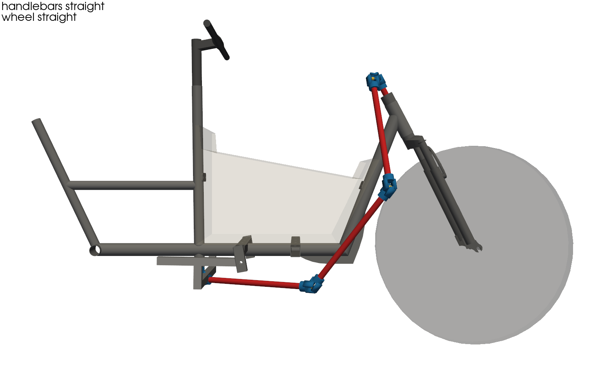 | 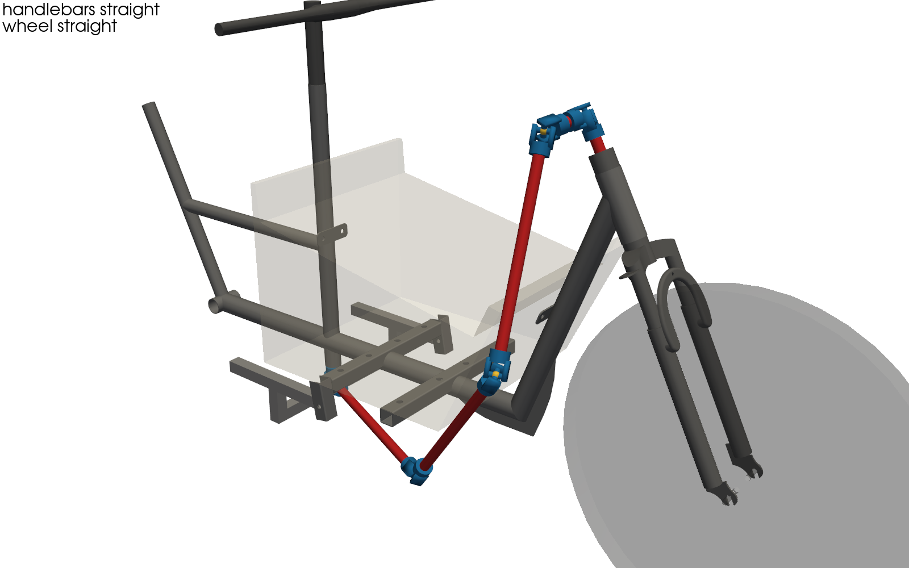 |

| Under the handlebar post | Above the head tube |
| --- | --- |
| 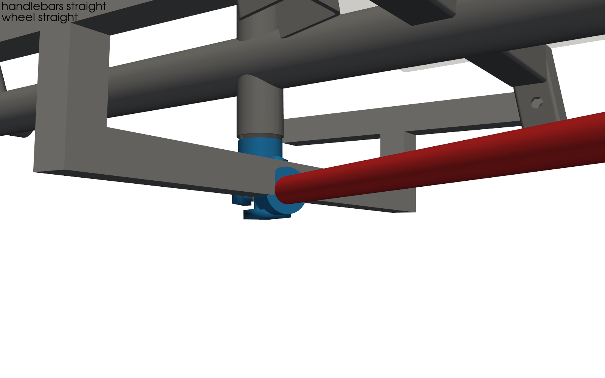 | 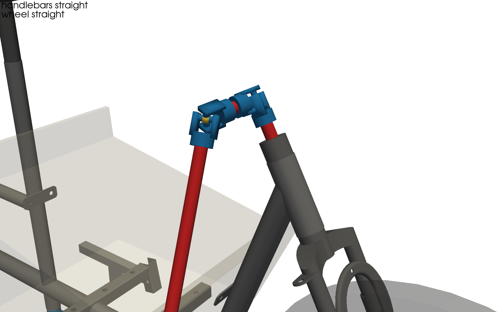 |

| Bottom corner | The shafts and joints alone |
| --- | --- |
| 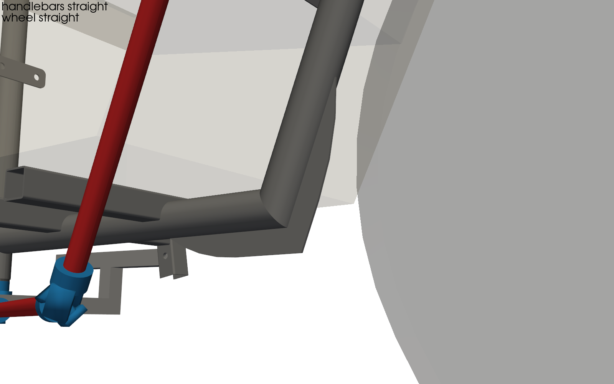 | 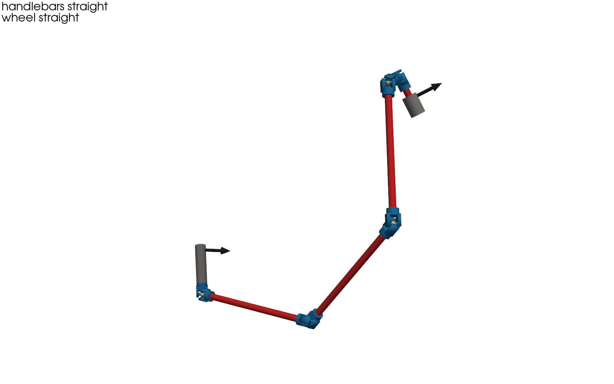 |

The model uses DIN 808 size 42 joints with a 20 mm bore and 20 mm shafts. A single U-joint is rated to 35° and a double one to 70°. A program searched for the joint positions with the smallest bends, keeping 8 mm from fixed parts and 10 mm from moving ones.

| Joint | Bend | Rating |
| --- | --- | --- |
| Under the handlebar post | 89.4° | 35° |
| Bottom corner, first | 52.1° | 35° |
| Bottom corner, second | 55.5° | 35° |
| Above the head tube, first | 59.4° | 35° |
| Onto the steerer | 89.4° | 35° |

- Under the post, the drive turns from the near-vertical post to a level shaft. The kickstand's folded front cross piece sits 19 mm below the post end and 8 mm in front of its axis, so no joint or gearbox fits there.
- Above the head tube, the drive comes up the diagonal shaft and turns down into the steerer, about 130° of turning in total, plus a step to the side.
- A single U-joint locks near 90°, so with two joints bent 89.4° the steering is unusable. The model gives no handlebar to fork ratio for the sketch.

## The strongest fix tried

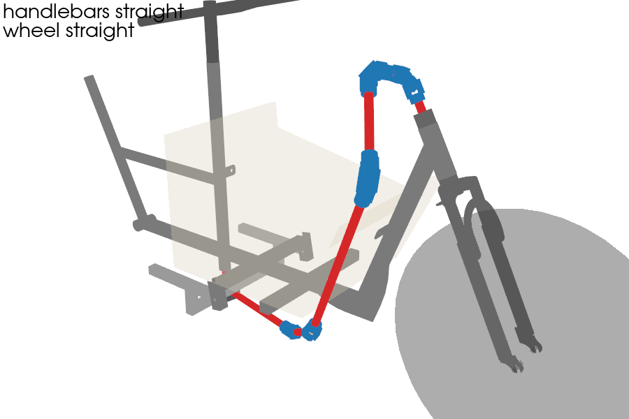

- A 1:1 right-angle bevel gearbox under the handlebar post, about a 60 mm cube, in place of the first U-joint.
- The kickstand's front cross piece cut and welded back 30 mm further forward, so the level shaft passes under it.
- Single U-joints in the bottom corner, bent 36.1° and 32.8°.
- Three double U-joints above the head tube, bent 72.1° apiece.

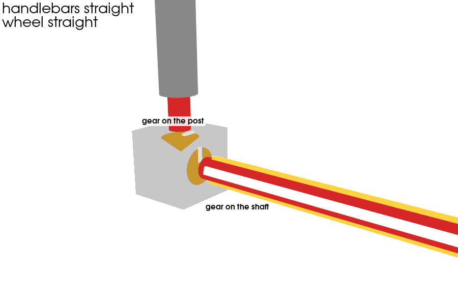

| Under the handlebar post | Above the head tube |
| --- | --- |
| 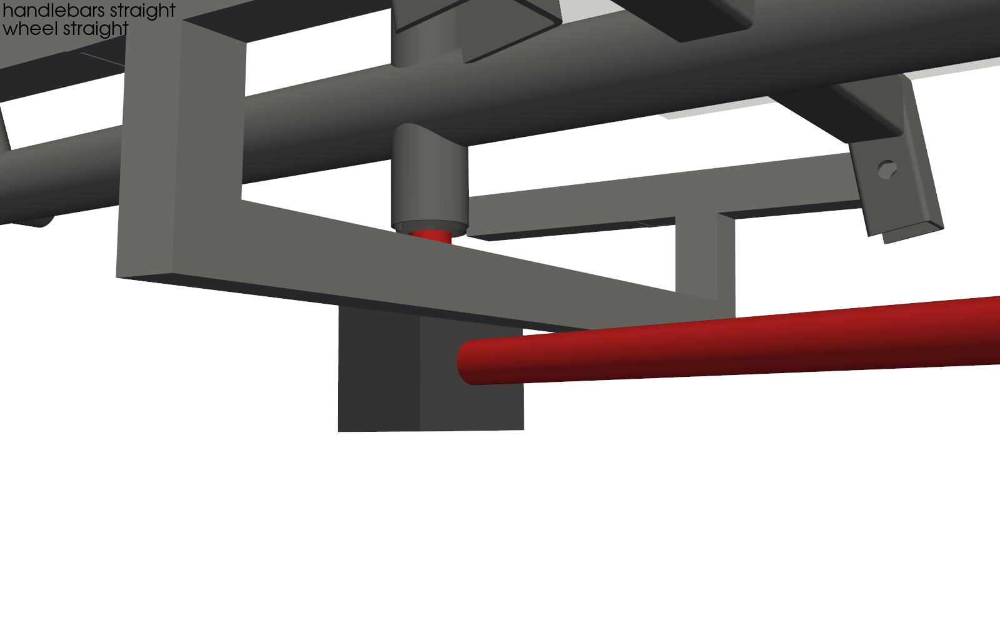 | 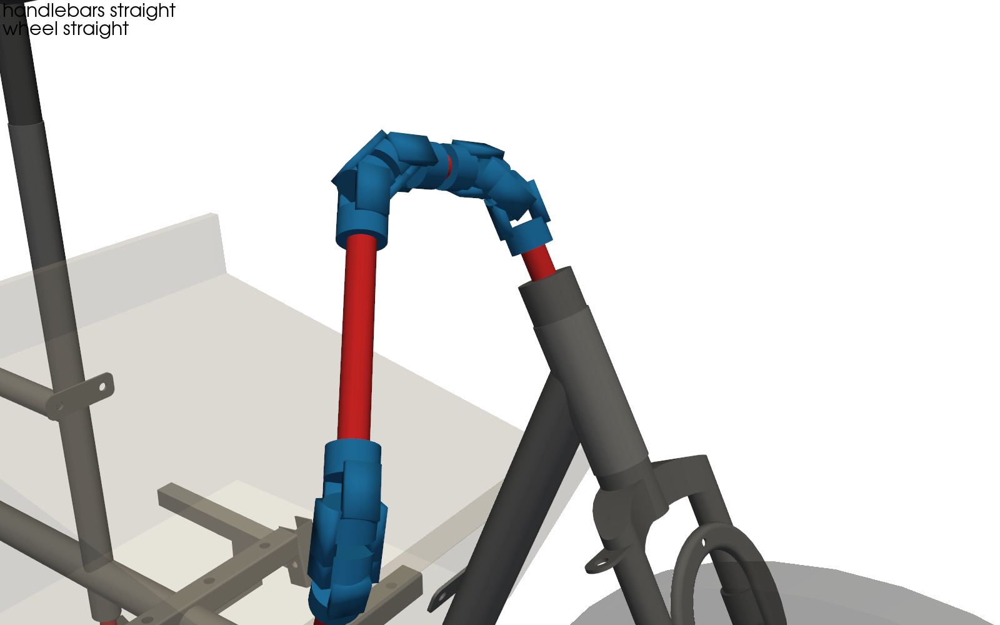 |

| From the side | The shafts and joints alone |
| --- | --- |
| 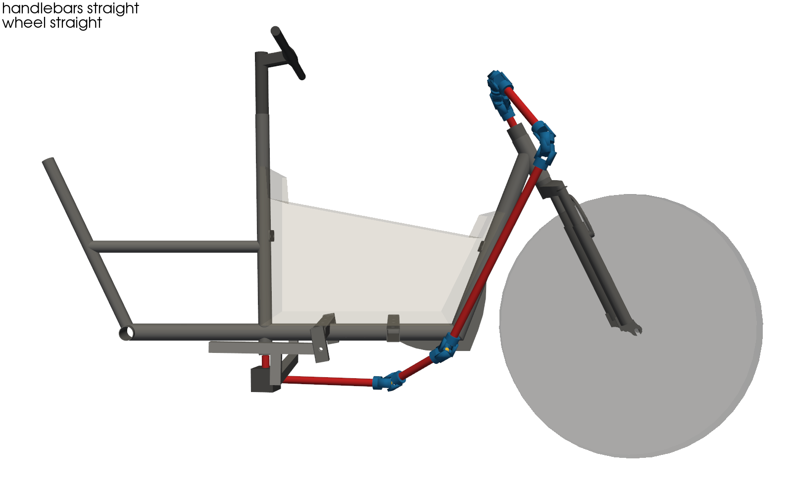 | 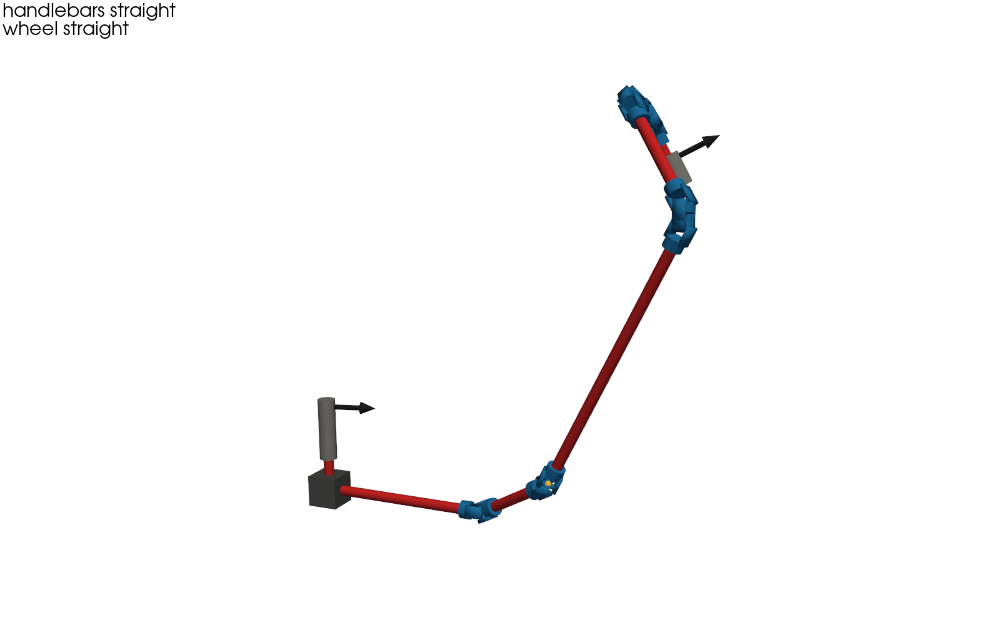 |

With the yokes twisted to the best angles, the wheel follows the handlebars to within 0.73° through 35° left to 35° right. With the yokes lined up, the error grows to 8.2°.

This version still has four joints over their rating: one single joint by 1.1° and all three double joints by 2.1°. It also needs the gearbox, a change to the kickstand and a welded frame part. The closest gaps are 1.7 mm from the gearbox to the kickstand, 5.9 mm from the level shaft to the kickstand and 10.8 mm from the diagonal shaft to the cargo box.

## Files

The `ujoint_*.py` files in [`mechanical/steering-sim`](../../../mechanical/steering-sim/README.md) hold the layout, the joint search, the gap check and the pictures. `ujoint_check.py sketch` and `ujoint_check.py fixed3` print the tables above.
