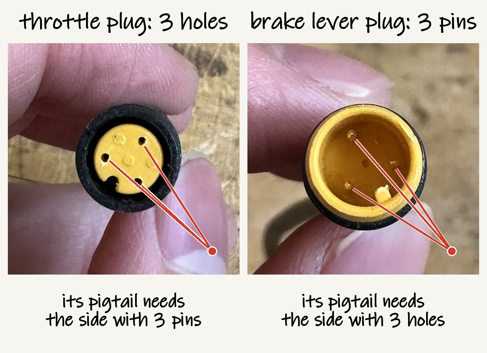
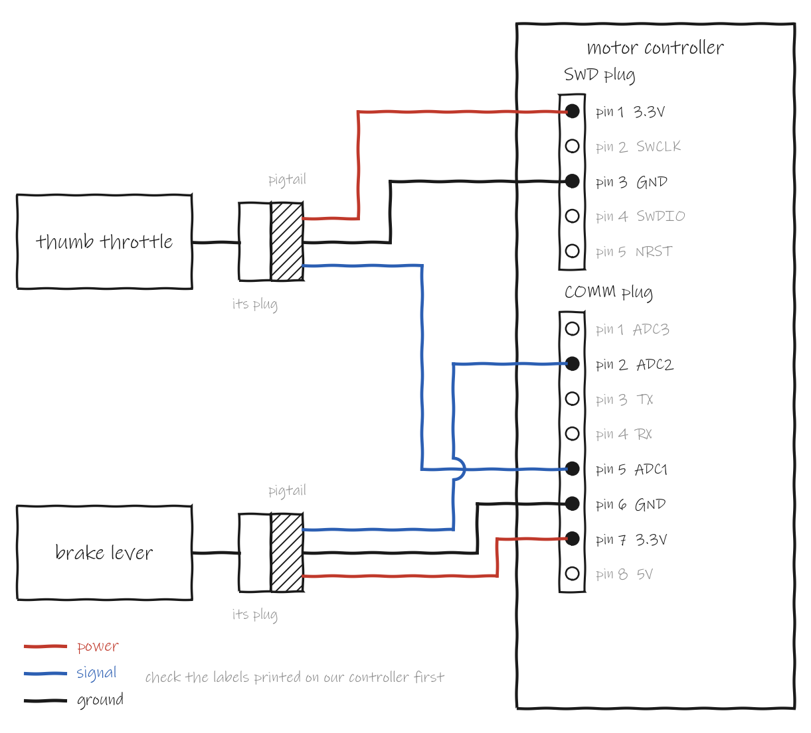
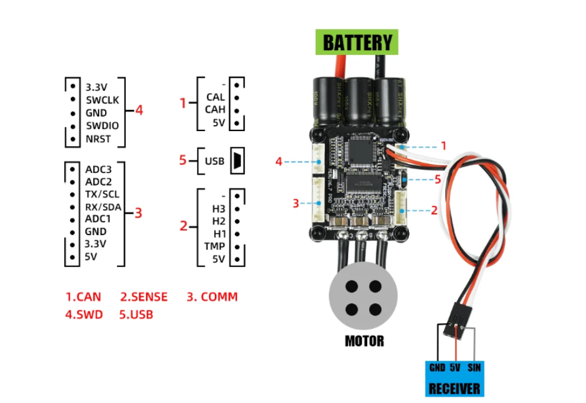

# Brake cut-off and throttle wiring

Pulling the rear brake lever stops the motor, and the thumb throttle sets how hard it pushes. This page shows how both connect to the motor controller ([#40](https://github.com/Electrium-Mobility/Bakfiets-F26/issues/40) and [#39](https://github.com/Electrium-Mobility/Bakfiets-F26/issues/39)). Updated 11 Nov 2026.

The brake lever and the thumb throttle both came from the bay. The bay has two identical brake levers with a cut-off wire. One goes on the rear brake now and the other can go on the front later.

Both parts end in a Julet 3-pin plug. The throttle's plug has 3 holes and the lever's plug has 3 pins. Each one connects to our wiring through a pigtail, which is a short cable with the matching half of the plug on one end and bare wires on the other. The pigtails are DKARDU Julet 3-pin extension cables from Amazon.ca, and each pair has both halves.

Where each wire goes:

| Wire | Brake lever | Thumb throttle |
| --- | --- | --- |
| Power | COMM plug pin 7 (3.3V) | SWD plug pin 1 (3.3V) |
| Ground | COMM plug pin 6 (GND) | SWD plug pin 3 (GND) |
| Signal | COMM plug pin 2 (ADC2) | COMM plug pin 5 (ADC1) |

The throttle takes its power and ground from the SWD plug so that each pin on the COMM plug holds one wire. The pin numbers come from Flipsky's port map below. Check them against the labels printed on our controller before wiring.

Before connecting anything to the controller:

1. Find out which of the brake lever's 3 wires is power. Power on the wrong wire can break the lever.
2. Test the lever on the bench. Power it from an ESP32 board's 3.3 V and measure the signal wire with a multimeter, once with the lever released and once pulled.

   

   | Released | Pulled | Setting in VESC Tool |
   | --- | --- | --- |
   | About 3.3 V | About 0 V | Kill Switch Mode ADC2 Low |
   | About 0 V | About 3.3 V | Kill Switch Mode ADC2 High |
   | Stays the same | Stays the same | Stop. It may need 5 V, which is too much for ADC2 |

3. Power the throttle from 3.3 V and measure its signal wire while pushing it all the way. It has to stay under 3.3 V.

Setting up the controller in VESC Tool:

- Brake. Go to App Settings > General > Kill Switch Mode. Pick ADC2 Low or ADC2 High from the test above. The motor stops when the signal crosses 1.65 V ([firmware source](https://github.com/vedderb/bldc/blob/master/timeout.c)).
- Throttle. Run the Setup Input wizard, choose ADC and use current control ([video](https://www.youtube.com/watch?v=6jtZYGD6Q_o)).
- If the ADC2 reading jumps around with nothing pressed, add a 10k resistor from 3.3V to ADC2.
- Write the configuration when you're done.

Checks before every ride:

- Lift the back wheel, spin the motor and pull the rear brake lever. The motor has to stop and only restart after you let go.
- Ease off the throttle when braking with the front brake, since its lever has no cut-off yet.

Later, the ESP32 reads the same brake signal to turn on the brake light ([#48](https://github.com/Electrium-Mobility/Bakfiets-F26/issues/48)).
