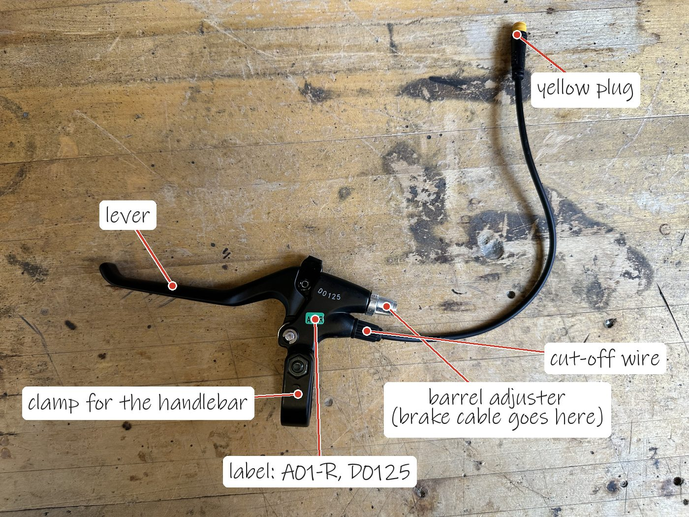
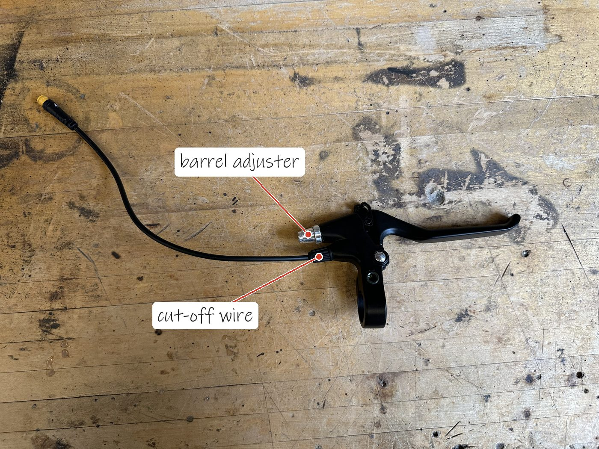
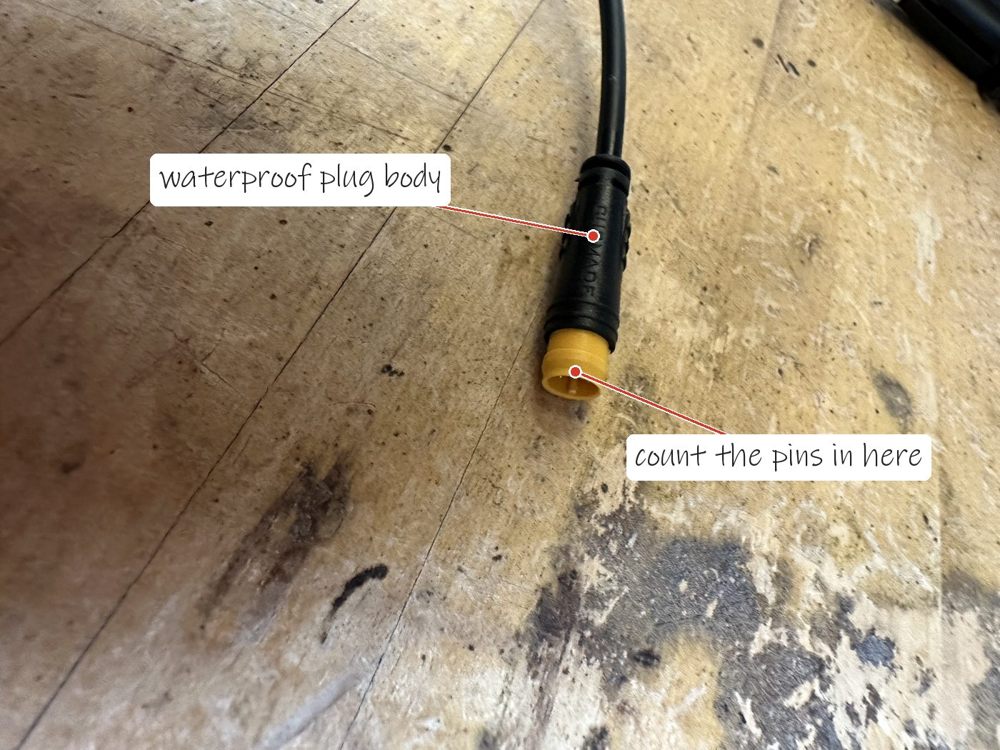
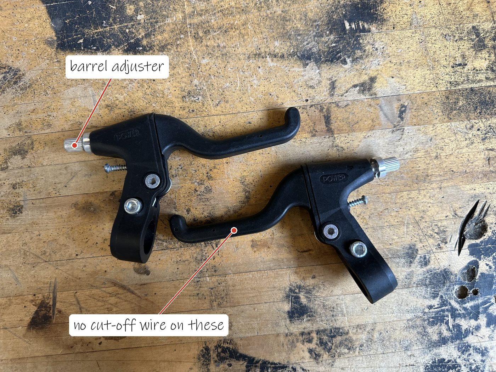
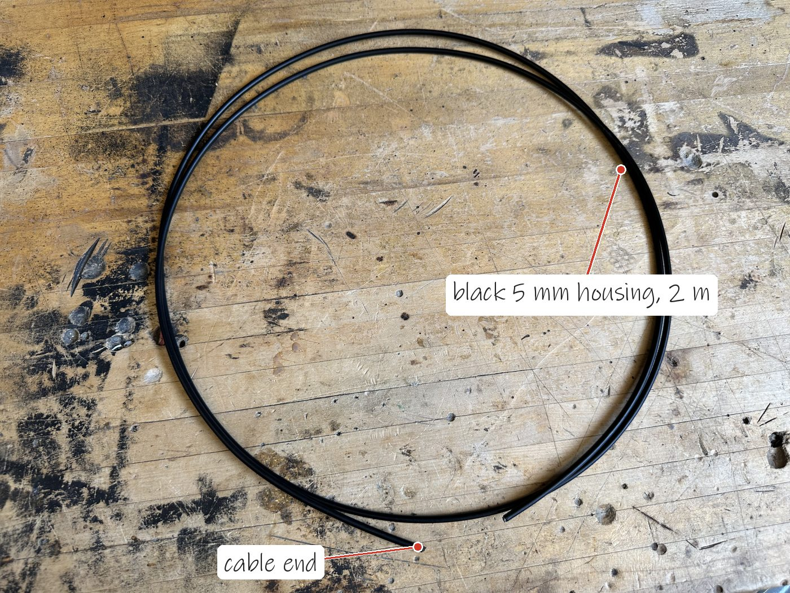
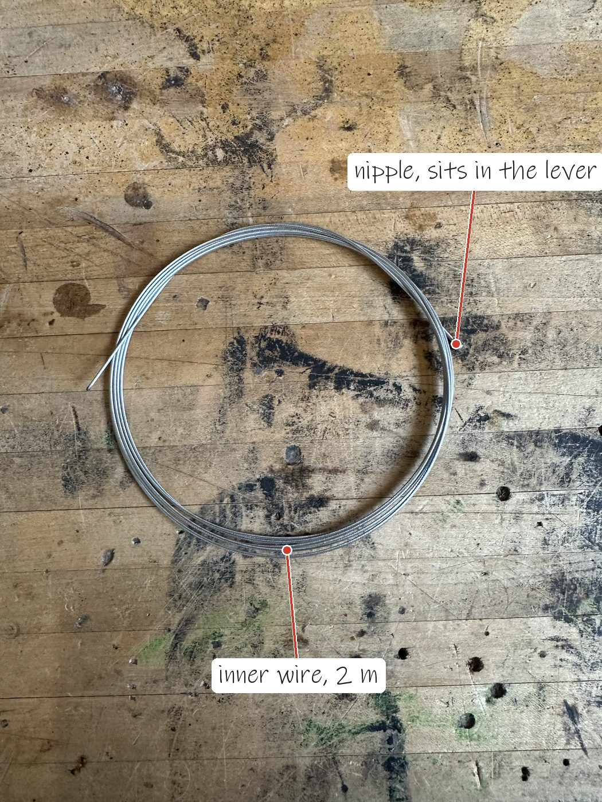
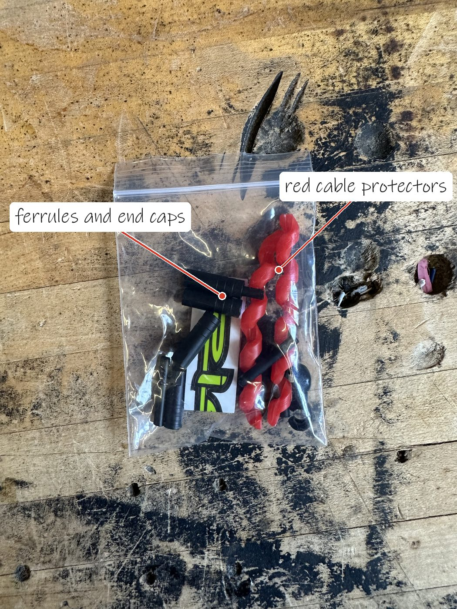
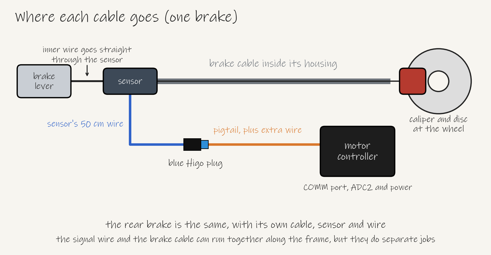
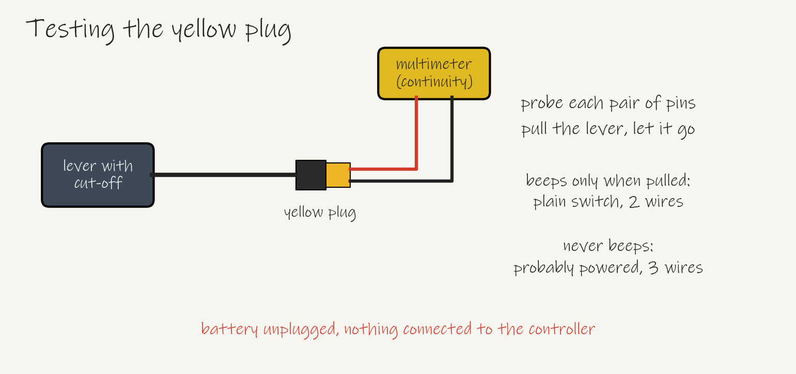
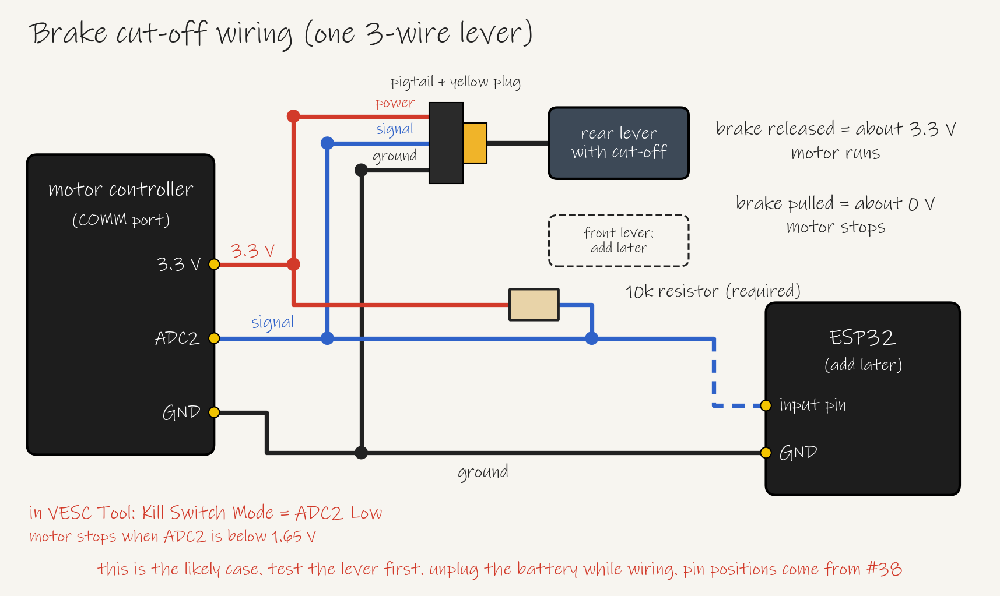

# Brake motor cut-off

This page explains how the motor stops when someone pulls a brake lever, which parts we're using, how to wire it and how to test it. It goes with [#40](https://github.com/Electrium-Mobility/Bakfiets-F26/issues/40). Updated 7 Nov 2026 after checking Electrium's spare parts in the bay.

This is a plan, and the circuit hasn't been built yet. The motor test on 4 Nov worked, so the controller, VESC Tool and motor are ready for this.

Why we need it: Ontario requires the motor to stop when the brakes are applied ([O. Reg. 369/09](https://www.ontario.ca/laws/regulation/090369), section 3(2)). It has to work before the first ride.

The bay has a lever with a cut-off built in. A switch or sensor inside the lever sends a signal down the thin wire whenever the lever is pulled, the same way store-bought e-bikes do it. We use that signal to stop the motor.

The cut-off wire ends in a yellow waterproof plug, known as a Higo or Julet plug.

The rest of the parts from the bay are below. The plain levers have no cut-off, so they're only a backup.

We're starting with the cut-off on the rear brake only, using the one lever we have. The front brake uses a plain lever for now, and the cut-off gets added to it later. Each brake uses one lever, one 2 m inner wire and one 2 m length of housing. The front line now runs along the box instead of along the frame, which is shorter than the 228 cm route we measured before. Measure both routes with a string, with the handlebars turned fully each way. The housing has to fit the route with some slack, and the inner wire has to be longer than the housing so it can reach the caliper.

There are two separate lines at each brake. The inner wire and housing stop the wheel. The cut-off wire stops the motor.

The cut-off wire is short, so it needs a pigtail, which is a short cable with the other half of the yellow plug, plus extra wire to reach the controller. Include this in the wiring harness ([#20](https://github.com/Electrium-Mobility/Bakfiets-F26/issues/20)).

The yellow plug has three pins, so the lever is most likely a powered sensor with three wires: power, ground and signal. The first job is finding out what the signal does when the lever is pulled. Test one lever on the bench with a 3-pin pigtail. Confirm which wire is power before connecting it, because wiring it backwards can kill the sensor. Pigtail colours vary, so don't go by colour alone.

| Lever released | Lever pulled | What to do |
| --- | --- | --- |
| About 3.3 V | About 0 V | Use the wiring below with Kill Switch Mode set to ADC2 Low |
| About 0 V | About 3.3 V | Move the 10k resistor so it goes from signal to ground, and set ADC2 High |
| Stays the same | Stays the same | Stop here. It may need 5 V, and on 5 V the signal could be too high for ADC2 and the ESP32. Ask Ayaan before going further |

Here's how the first case works, which is the most common on 3-wire levers. The resistor holds the signal at 3.3 V. Pulling a brake connects the signal to ground, so it drops to about 0 V. The signal goes to ADC2, an input pin on the controller's COMM port. The VESC firmware has a kill switch setting called ADC2 Low, which stops the motor whenever ADC2 is below 1.65 V ([firmware source](https://github.com/vedderb/bldc/blob/master/timeout.c)).

The 10k resistor is required. An unconnected ADC2 can float to a random voltage, and [one builder measured 1.2 V](https://foil.zone/t/magnet-operated-kill-switch/15715/25), which is below the 1.65 V trigger.

Before building, read the controller's model and firmware version in VESC Tool and post them on [#38](https://github.com/Electrium-Mobility/Bakfiets-F26/issues/38). The model tells us where 3.3 V, ADC2 and GND are on the COMM port. The kill switch was [added to the firmware in June 2021](https://github.com/vedderb/bldc/commits/master/timeout.c), so older firmware needs updating first.

Build it on a breadboard first, with the battery unplugged whenever you change a wire.

1. Test the lever using the picture above and pick the setting from the table.
2. Connect one lever using the table below.
3. Watch the ADC2 voltage in VESC Tool's live data while pulling the lever. It should match what you measured.
4. Set Kill Switch Mode in App Settings and write the configuration. Menu names can vary a little between versions.
5. With the back wheel lifted and the current limits low, spin the motor and pull the lever. The motor should stop, and restart only once the lever is released.
6. Add the ESP32 for the brake light.
7. Later, connect a front cut-off lever the same way and test each brake.

| From | To |
| --- | --- |
| Controller 3.3 V | Red breadboard rail |
| Controller GND | Blue breadboard rail |
| Rear lever power | Red rail |
| Rear lever ground | Blue rail |
| Rear lever signal | Signal row |
| 10k resistor | Signal row to red rail |
| Signal row | Controller ADC2 |
| ESP32 GND (step 6) | Blue rail |
| Signal row (step 6) | ESP32 input pin, through a 1k resistor |

Breadboards are for the bench only, because jumper wires can shake loose on a bike. Once it works, move the circuit to perfboard with screw terminals.

The ESP32 only reads the signal for the brake light. The signal is 0 V or 3.3 V, so it's safe for the ESP32-S3, whose pins aren't rated for 5 V. The 1k resistor protects the pin if the ESP32 is off while the controller is on. The cut-off doesn't depend on the ESP32, and the firmware [ignores commands while the kill switch is active](https://github.com/vedderb/bldc/commits/master/timeout.c). Confirm that during testing once the CAN link works.

Fit the levers on the bike and check these before the first ride:

- The lever pulls enough cable to clamp the Shimano mechanical caliper firmly before the lever reaches the grip. Linear pull and short pull levers move different amounts of cable, and these levers haven't been tested with our calipers yet.
- The levers clamp onto our handlebars.
- With the back wheel lifted, pulling the rear brake stops the motor. Repeat this check before every ride. A broken signal wire or an unplugged lever leaves the motor running, although the brakes still work.
- The front brake doesn't cut the motor yet, so let go of the throttle when braking. Add the front cut-off before riding on the road.

When we add the front cut-off, it can be a second matching lever, or a plain lever with a [Grin inline sensor](https://ebikes.ca/inline-cable-cutoff-sensor.html), CA$21, once we confirm its signal. Its wiring would differ from a 3-wire lever, so two matching levers are simpler.

Still open:

- A cut-off for the front brake, when we add it. The bay's lever is labelled A01-R, and the photos show only one.
- What the yellow plug's signal does when the lever is pulled, and which wire is which.
- Which 3-pin pigtail fits the yellow plug.
- The controller's model and COMM pinout ([#38](https://github.com/Electrium-Mobility/Bakfiets-F26/issues/38)).
- The string measurements for both routes.
- Which ESP32 input pin to use (firmware).
