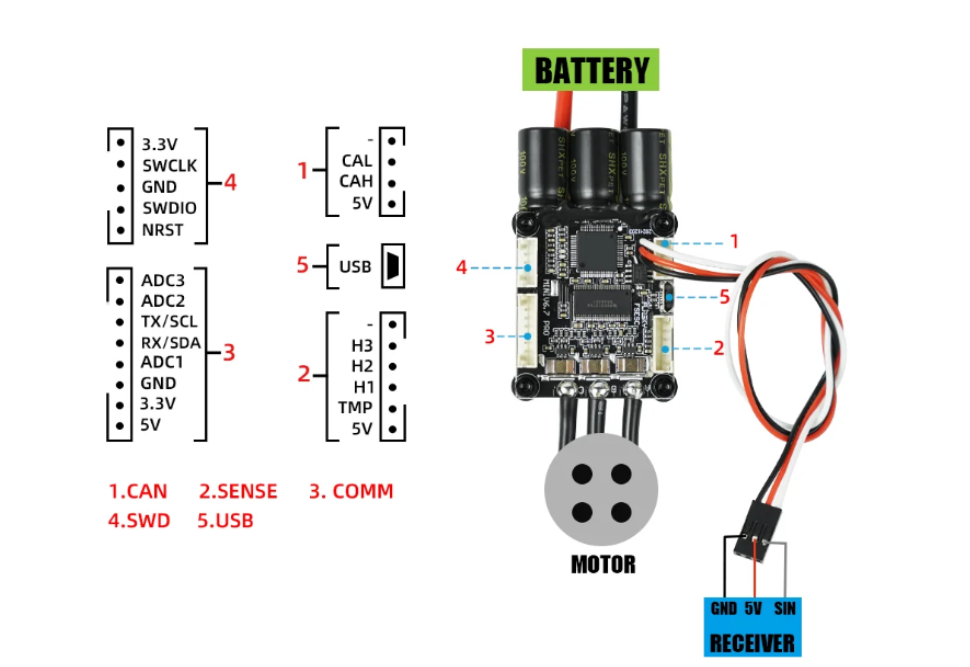

# Motor Controller Research
This page reports information on the motor controller used in bakfiets 2026.

Related task: [Issue #38](https://github.com/Electrium-Mobility/Bakfiets-F26/issues/38)

## Firmware, Hardware and UUID
- **Firmware Version:** 7.00

- **Hardware Name:** 60

- **Hardware UUID:** 48 00 18 00 10 36 31 57 4C 39 43 53

## Current limits
- **Motor Current Max:** 70.89A

- **Battery Current Max:** 99.00A

- **Battery Voltage Cutoff Start:** 40.8V

- **Battery Voltage Cutoff End:** 36.0V

These values are what the controller are set to currently. At 48V the battery current would be 4752 W which far exceeds the 500 W limit.

## Hardware Information
- **Manufacturer:** Flipsky

- **Model:** Mini FSESC v6.7 Pro

- **Maximum Input Voltage:** 14V-60V

- **Continuous Motor Current:** 70A

- **Peak Motor Current:** 200A

Issue #38 requires a maximum input voltage of 60V or more and a motor current around 40A. The published voltage meets the requirement with a max of 60V but Flipsky notes that voltage spikes must not exceed that value. The published continuous motor current is 70A which is sufficient.

## Port Map
The diagram is from Flipsky's website for the part ([here](https://flipsky.net/collections/v6-series/products/mini-fsesc6-7-pro-70a)).

The white plugs on the controller are JST-PH 2.0mm. The distance between the center of the first and last pin of the 8-position header is 14mm, so the pitch is 2.0mm.

| Connection | Location | Type of connection |
|---|---|---|
| **Battery leads** | Top of controller, beside capacitors | Two 12 AWG power leads soldered to the PCB|
| **Motor phase wires** | Bottom edge of controller | Three 12 AWG leads soldered to PCB pads   Motor-side ends use male banana plugs|
| **Hall sensor port** | **Connector 2** | 6-position SENSE header|
| **ADC1 (throttle)** | **Connector 3, pin 5** | One signal contact in COMM header|
| **ADC2 (brake cut-off)** | **Connector 3, pin 2** | One signal contact in COMM header|
| **UART** | **Connector 3:** TX at pin 3, RX at pin 4, GND at pin 6 | Three contacts within the 8-position COMM header|
| **CAN** | **Connector 1:** CAN-L at pin 2, CAN-H at pin 3, GND at pin 1 | 4-position CAN header |
| **3.3 V and 5 V pins** | **3.3 V:** connector 3, pin 7; connector 4, pin 1.   **5 V:** connector 1, pin 4; connector 2, pin 6; connector 3, pin 8. | Individual power contacts found in various headers|
