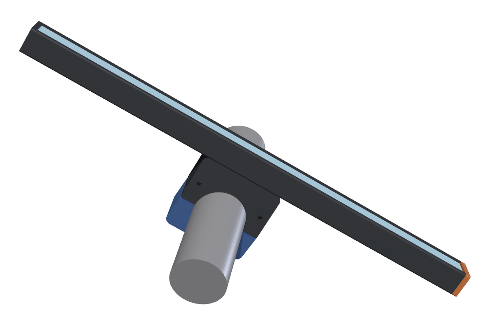

# Rear light housing

A 3D-printed housing for one 36-LED strip, clamped to the round frame tube behind the seat. It holds the back bar: the rear turn signals and the brake light, run from one sketch in [#80](https://github.com/Electrium-Mobility/Bakfiets-F26/issues/80).

Four printed parts, all PETG, and four M3 screws. The strips come from the bay's 1 m strip, cut into four 36-LED pieces in [#79](https://github.com/Electrium-Mobility/Bakfiets-F26/issues/79). The bench test that started this is in [#77](https://github.com/Electrium-Mobility/Bakfiets-F26/issues/77).

*Left to right in the render: the clamp, wrapped round the grey tube, holding the black body above it, with the clear lid in the body's face and the end cap at the far end.*

## Files

| File | What it is |
| --- | --- |
| [`rear_light.py`](rear_light.py) | Makes all four parts. Change a number at the top and run it |
| `print/*.stl` | The four parts, already oriented for printing |

## Print

| File | Filament | Orientation | Notes |
| --- | --- | --- | --- |
| `rear-light-body.stl` | Black or white PETG | Upside down: lid opening on the bed, tube saddle pointing up | No supports. Diagonal, it needs a 213 × 213 mm bed, so it fits 220 × 220 and up but not a 200 × 200 one |
| `rear-light-lid.stl` | Clear (natural) PETG | Flat | The diffuser. 100 % infill. Diagonal, it needs 193 × 193 mm, so it fits a 200 × 200 bed |
| `rear-light-end-cap.stl` | Same as the body | Flat face down, prongs up | 18 mm, print it with anything |
| `rear-light-clamp.stl` | Same as the body | Counterbores down, bore up | 46 mm, print it with anything |

0.4 mm nozzle, 0.2 mm layers, 4 perimeters, 20 % infill. Nothing here needs supports. The four meshes measure 50.6 cm³ of material (body 37.4, clamp 7.9, lid 4.5, cap 0.8), so budget about 65 g of PETG at 1.27 g/cm³. The lid is thin enough that 100 % infill costs nothing and stops it scattering light through infill lines.

PETG shrinks a little, so the 0.2 mm bore clearance may end up tight. If the clamp will not close over the tube, ream the bore with a 29 mm sanding drum rather than forcing it on.

## Hardware

| Part | Qty |
| --- | --- |
| M3 × 10 socket head screw | 4 |
| M3 hex nut | 4 |
| Clear silicone | 1 tube |
| 2.5 mm hex key, long | 1 |

An M3 × 10 goes through the clamp counterbore, across the 1 mm gap and all the way through the nut, so it does not bottom out before the gap closes.

## Assemble

1. Stick the strip into the body with its wires at the open end. The cavity is 13.0 mm wide and 9.0 mm deep, and the strip sits on the floor with 7.0 mm of clearance under the lid.
2. Slide the lid in from the open end, into the 1.0 mm groove. It runs 257.7 mm and stops 0.3 mm short of the far wall.
3. Drop the cable into the notch in the end cap and press the cap in. Each prong is 6.0 mm long and pushes 3.6 mm past the 2.4 mm wall into the cavity, with 1 mm ribs biting into the side.
4. Seal the end cap, the cable notch and both lid seams with clear silicone. Let it cure before the bike goes out.
5. Slide the 4 nuts into the side slots of the tube mount. Close the clamp around the tube, start all four screws from underneath, then tighten them evenly with the long 2.5 mm hex key until the gap is almost closed.

## Sizes

- **Strip:** 36 LEDs × (1000 / 144) mm = 250.0 mm. The housing leaves 4.47 mm from the end LED to the wall at both ends.
- **Body:** 260.4 × 17.8 × 13.9 mm channel, 40.0 mm tall over the tube saddle, and 263.4 mm long with the end cap fitted. The lid is 257.7 × 14.6 × 1.2 mm and sits 1.0 mm into the groove, so the body needs a 213 × 213 mm bed laid diagonally at 45°.
- **Tube:** 28.6 mm, the seat tube in [`cad-2024/Weldment Cross-section`](../../cad-2024/). The bore is 29.0 mm, so 0.2 mm of clearance all round, which is snug for PETG. That tube size is still unverified: [#4](https://github.com/Electrium-Mobility/Bakfiets-F26/issues/4) closed after measuring the wheelbase, the box and the head tube angle, but not the tube sizes. Measure the real tube before printing.
- **Tilt:** the clamp is angled 17° so the light faces straight back on a 73° seat tube.
- **Strip width:** assumed 12 mm. Measure the strip before printing.

## Change a size

Edit the numbers at the top of `rear_light.py` and run `python3 rear_light.py`. It needs `pip install cadquery` and writes new STL files to `print/`.

The ones worth touching:

- `TUBE_D` if the seat tube is not 28.6 mm. This changes the bore and both screw positions.
- `STRIP_W` if the strip is not 12 mm wide.
- `TILT` if the seat tube is not 73°.
- `LEDS` if the strip is not 36 LEDs.

## Still open

- The tube diameter and the strip width are both unmeasured. Check them on the real parts before a print goes on the bed.
- Nothing here covers the front bar or the two cargo box sides. They need their own mounts.
